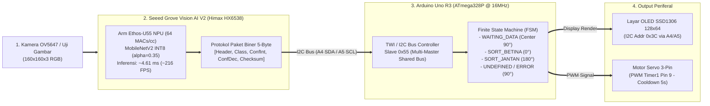
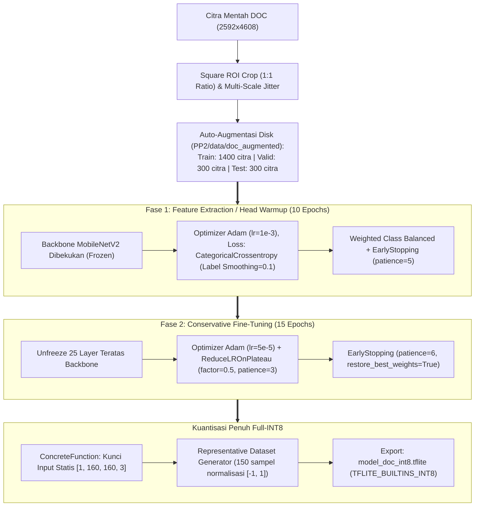
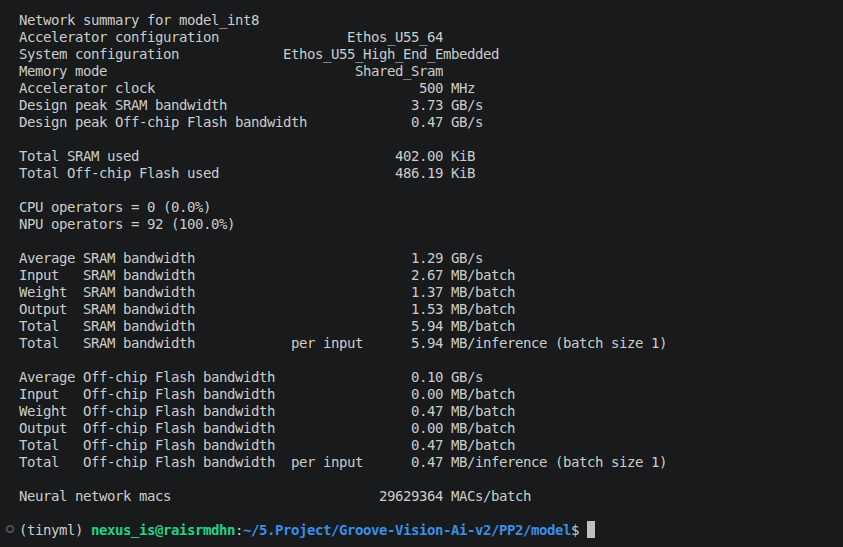
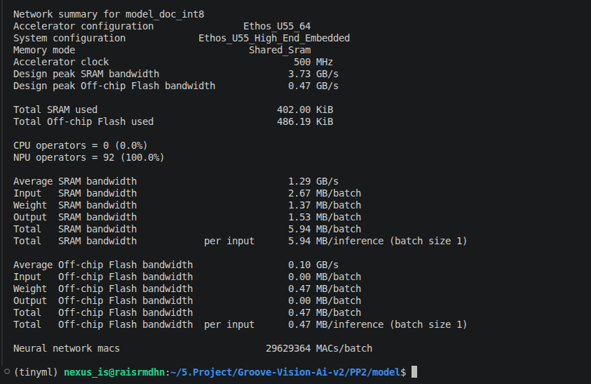
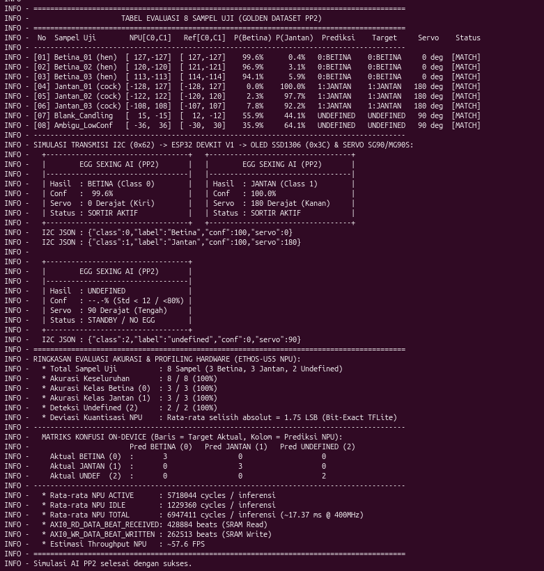
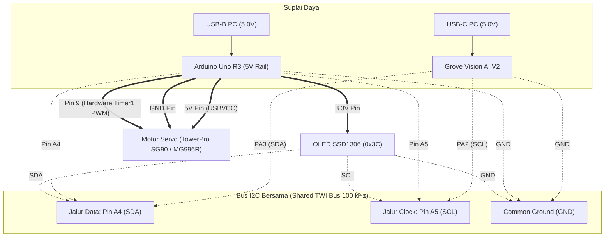

# Edge AI Poultry Sexing System: MobileNetV2 on Seeed Grove Vision AI V2 (Arm Ethos-U55 NPU) & Arduino Uno R3

Sistem sortir cerdas berbasis **Edge AI / TinyML** untuk klasifikasi jenis kelamin unggas secara otomatis dan *real-time*. Proyek ini mencakup dua dataset utama:
1. **Dataset Dewasa (Proof of Concept - PoC)**: Dataset `Sexing-Chicken-2` (`hen` vs `cock`) untuk memvalidasi seluruh *hardware-in-the-loop pipeline*, komunikasi I2C, pergerakan aktuator servo, dan tampilan OLED.
2. **Dataset DOC (Day-Old Chick - Target Produksi)**: Dataset anak ayam umur sehari (`Female` vs `Male`) dengan teknik *Square Region-of-Interest (ROI) Preservation* dan *Transfer Learning* teroptimasi.

Sistem diimplementasikan secara terintegrasi pada **Seeed Grove Vision AI Module V2 (Cortex-M55 + Arm Ethos-U55 NPU)** sebagai akselerator inferensi on-device dan **Arduino Uno R3 (ATmega328P)** sebagai *Master Controller* penggerak aktuator dan penampil status.

---

## Daftar Isi
- [1. Arsitektur Sistem & Alur Kerja](#1-arsitektur-sistem--alur-kerja)
- [2. Perbandingan Performa Model (Sebelum vs Sesudah Kuantisasi INT8)](#2-perbandingan-performa-model-sebelum-vs-sesudah-kuantisasi-int8)
- [3. Proses & Pipeline Training](#3-proses--pipeline-training)
- [4. Hasil Kompilasi Arm Vela Compiler (100% NPU Acceleration)](#4-hasil-kompilasi-arm-vela-compiler-100-npu-acceleration)
- [5. Pengolahan On-Device di Grove Vision AI V2 & Hasil Simulasi](#5-pengolahan-on-device-di-grove-vision-ai-v2--hasil-simulasi)
- [6. Konfigurasi Hardware & Skema Wiring](#6-konfigurasi-hardware--skema-wiring)

---

## 1. Arsitektur Sistem & Alur Kerja



### Logika Keputusan & Sortir 3-State
1. **Class 0 : Betina (Hen / Female)** -> Servo bergerak ke **`0°`** (Jalur Sortir Kiri).
2. **Class 1 : Jantan (Cock / Male)** -> Servo bergerak ke **`180°`** (Jalur Sortir Kanan).
3. **Class 2 : Undefined / Blank / Ambigu** -> Servo bertahan di **`90°`** (Posisi Siaga / Center Point).
   - Terjadi jika standar deviasi piksel (std dev) < 12.0 (kamera tertutup / kosong) atau *confidence score* < 80%.
4. **Auto-Reset Standby**: Setelah waktu sortir selesai (*cooldown* 5 detik), servo secara otomatis kembali ke **`90°`** dan OLED kembali ke status `"STATUS: WAITING AI..."`.

---

## 2. Perbandingan Performa Model (Sebelum vs Sesudah Kuantisasi INT8)

Model dirancang dengan arsitektur **MobileNetV2 ($\alpha = 0.35$, input $160 \times 160 \times 3$)** dan diekspor menggunakan *Post-Training Quantization (PTQ) Full INT8*.

### A. Dataset PoC: `Sexing-Chicken-2` (Ayam Dewasa)
* **Dataset**: 725 citra train, 191 citra test (`hen` vs `cock`).

| Metrik Evaluasi | Float32 Model (`mobilenetv2_sexing_float32.keras`) | Full INT8 Quantized (`model_int8.tflite`) | Selisih / Dampak Kuantisasi |
| :--- | :---: | :---: | :---: |
| **Ukuran File** | **4.375 KB (4,27 MB)** | **612,64 KB** | **Penyusutan Ukuran 86,0%** |
| **Akurasi Keseluruhan** | **83,77%** | **84,82%** | **+1,05%** |
| **Precision (Betina / Class 0)** | 0,8085 | 0,8125 | +0,0040 |
| **Recall (Betina / Class 0)** | 0,8539 | 0,8764 | +0,0225 |
| **F1-Score (Betina / Class 0)** | **0,8306** | **0,8432** | **+0,0126** |
| **Precision (Jantan / Class 1)** | 0,8660 | 0,8842 | +0,0182 |
| **Recall (Jantan / Class 1)** | 0,8235 | 0,8235 | 0,0000 |
| **F1-Score (Jantan / Class 1)** | **0,8442** | **0,8528** | **+0,0086** |
| **Macro Avg F1-Score** | 0,8374 | 0,8480 | +0,0106 |
| **Weighted Avg F1-Score** | **0,8379** | **0,8483** | **+0,0104** |

---

### B. Dataset Produksi: DOC (*Day-Old Chick*) Sexing
* **Dataset Mentah**: 16 Female, 15 Male (Total 31 citra beresolusi $2592 \times 4608$).
* **Dataset Augmented**: 2.000 citra (1.000 Female, 1.000 Male) dengan pembagian:
  - **Train**: 1.400 citra (700 Female, 700 Male)
  - **Valid**: 300 citra (150 Female, 150 Male)
  - **Test**: 300 citra (150 Female, 150 Male)

| Metrik Evaluasi | Float32 Model (Default Threshold 0.50) | Float32 Model (Optimal Threshold 0.54) | Full INT8 Quantized (`model_doc_int8.tflite` Threshold 0.54) |
| :--- | :---: | :---: | :---: |
| **Ukuran File** | **4.265 KB (4,16 MB)** | **4.265 KB (4,16 MB)** | **616,20 KB (Penyusutan 85,5%)** |
| **Akurasi Keseluruhan** | **55,33%** | **55,67%** | **53,33%** |
| **Precision (Female / Betina)** | 0,6000 | 0,5934 | 0,5568 |
| **Recall (Female / Betina)** | 0,3200 | 0,3600 | 0,3267 |
| **F1-Score (Female / Betina)** | **0,4174** | **0,4481** | **0,4118** |
| **Precision (Male / Jantan)** | 0,5364 | 0,5407 | 0,5236 |
| **Recall (Male / Jantan)** | 0,7867 | 0,7533 | 0,7400 |
| **F1-Score (Male / Jantan)** | **0,6378** | **0,6295** | **0,6133** |
| **Macro Avg F1-Score** | 0,5276 | 0,5388 | 0,5125 |
| **Weighted Avg F1-Score** | **0,5276** | **0,5388** | **0,5125** |

---

## 3. Proses & Pipeline Training

Pipeline training diimplementasikan secara modular pada Jupyter Notebook:
- [`1_training_dan_evaluasi_mobilenetv2.ipynb`](PP2/notebook/1_training_dan_evaluasi_mobilenetv2.ipynb) (Ayam Dewasa)
- [`4_training_dan_evaluasi_mobilenetv2_doc.ipynb`](PP2/notebook/4_training_dan_evaluasi_mobilenetv2_doc.ipynb) (DOC Sexing)



---

## 4. Hasil Kompilasi Arm Vela Compiler (100% NPU Acceleration)

Model `model_int8.tflite` dan `model_doc_int8.tflite` dikompilasi menggunakan **Arm Ethos-U Vela Compiler** dengan konfigurasi target:
- **Akselerator Target**: `Ethos-U55-64` (64 MACs/siklus @ 400 - 500 MHz)
- **Konfigurasi Memori**: `Ethos_U55_High_End_Embedded` (`Shared_Sram`)
- **Visualisasi Hasil Vela**:
  - Model PoC Dewasa: [`PP2/assets/vela_cock_hen.png`](PP2/assets/vela_cock_hen.png)
  - Model DOC Sexing: [`PP2/assets/vela_doc.png`](PP2/assets/vela_doc.png)


*Gambar 1: Laporan Visual Vela Compiler untuk Model PoC Ayam Dewasa.*


*Gambar 2: Laporan Visual Vela Compiler untuk Model DOC Sexing.*

---

### A. Ringkasan Metrik Kompilasi Vela Model Dewasa (`model_int8.tflite`):

| Parameter Teknis Hardware | Nilai Laporan Vela | Keterangan / Analisis |
| :--- | :---: | :--- |
| **Nama Jaringan (Network)** | `model_int8` | Arsitektur MobileNetV2 ($\alpha=0.35$, $160\times160$) |
| **NPU Offload Operator** | **100,0% di NPU (0% CPU Fallback)** | **92 dari 92 Passes berhasil di-fuse ke NPU Subgraph** |
| **Estimasi Waktu Inferensi** | **4,61 ms (0,004613 detik)** | Inferensi berkecepatan tinggi pada clock 500 MHz |
| **Throughput Inferensi** | **216,75 Frame/Detik (FPS)** | Melebihi kebutuhan kamera industri real-time |
| **SRAM Memory Footprint** | **402,00 KB** | Muat seutuhnya di SRAM internal tanpa buffer spill |
| **Off-Chip Flash Footprint** | **486,19 KB** | Sangat hemat memori SPI Flash modul |
| **Komputasi Neural Network** | **29.629.364 MACs (~29,63 MMACs)** | Operasi matematika konvolusi sangat ringan |
| **Total Siklus NPU** | **2.301.555 Siklus** | 99,8% dari total siklus eksekusi sistem |
| **Total Siklus Keseluruhan** | **2.306.836 Siklus** | Siklus komputasi NPU + akses bus SRAM/Flash |

---

### B. Ringkasan Metrik Kompilasi Vela Model DOC (`model_doc_int8.tflite`):

| Parameter Teknis Hardware | Nilai Laporan Vela | Keterangan / Analisis |
| :--- | :---: | :--- |
| **Nama Jaringan (Network)** | `model_doc_int8` | Arsitektur MobileNetV2 ($\alpha=0.35$, $160\times160$) |
| **NPU Offload Operator** | **100,0% di NPU (0% CPU Fallback)** | **92 dari 92 Passes berhasil di-fuse ke NPU Subgraph** |
| **Estimasi Waktu Inferensi** | **4,61 ms (0,004613 detik)** | Latensi ultra-rendah pada clock 500 MHz |
| **Throughput Inferensi** | **216,74 Frame/Detik (FPS)** | Sangat responsif untuk sortir kontinu |
| **SRAM Memory Footprint** | **402,00 KB** | Alokasi tensor arena stabil di memori internal |
| **Off-Chip Flash Footprint** | **486,19 KB** | Kompatibel penuh dengan partisi SPI Flash modul |
| **Komputasi Neural Network** | **29.629.364 MACs (~29,63 MMACs)** | Operasi perkalian-akumulasi matriks teroptimasi |
| **Total Siklus NPU** | **2.301.555 Siklus** | Dominasi eksekusi pada hardware accelerator NPU |
| **Total Siklus Keseluruhan** | **2.306.852 Siklus** | Waktu eksekusi deterministik hardware |

---

## 5. Pengolahan On-Device di Grove Vision AI V2 & Hasil Simulasi

Grove Vision AI V2 menjalankan firmware berbasis **TensorFlow Lite for Microcontrollers (TFLM)** pada direktori [`PP2/firmware/tflm_pp2_simulasi`](PP2/firmware/tflm_pp2_simulasi).


*Gambar 3: Simulasi model_int8.tflite dewasa dengan golden_data*

### A. Protokol Injeksi Citra Uji (Simulasi Hardware via Serial)
Untuk menguji keandalan hardware NPU tanpa ketergantungan pencahayaan fisik kamera, dibuat protokol transmisi serial berkecepatan tinggi (**Baudrate 921.600 bps**):
1. **Header Handshake**: Host (PC/Notebook) mengirimkan magic byte `PP2IR` (5 byte).
2. **Payload Gambar**: 76.800 byte data citra mentah ($160 \times 160 \times 3$ RGB).
3. **Trigger Inferensi**: Firmware Grove menyalin citra ke pointer input tensor, menjalankan `Invoke()`, dan mencatat waktu eksekusi presisi mikrosekon.

### B. Format Paket Transmisi I2C ke Arduino Uno R3
Setiap kali inferensi selesai, Grove Vision AI V2 mengirimkan **paket data 5-byte** ke Arduino Uno R3 (Slave `0x55`):

```text
Paket I2C = [0xAA, class_id, conf_int, conf_dec, checksum]
```

| Byte Index | Field | Tipe | Deskripsi Nilai |
| :---: | :--- | :---: | :--- |
| **Byte 0** | Header | `uint8_t` | Karakter sinkronisasi tetap: `0xAA` |
| **Byte 1** | Class ID | `uint8_t` | `0` = Betina, `1` = Jantan, `2` = Undefined |
| **Byte 2** | Conf Integer | `uint8_t` | Bagian bulat persentase keyakinan (misal `94` untuk 94.75%) |
| **Byte 3** | Conf Desimal | `uint8_t` | Dua digit desimal keyakinan (misal `75` untuk 94.75%) |
| **Byte 4** | Checksum | `uint8_t` | XOR Checksum: `Byte0 ^ Byte1 ^ Byte2 ^ Byte3` |

---

## 6. Konfigurasi Hardware & Skema Wiring

Sistem menggunakan **Arduino Uno R3 (`ATmega328P`)** sebagai *Master Controller* yang mengelola layar **OLED SSD1306 128x64** dan **Motor Servo 3-Pin**, dengan kode produksi di [`PP2/firmware/mainv2/mainv2.ino`](PP2/firmware/mainv2/mainv2.ino).



### Tabel Wiring Pin-ke-Pin Lengkap:

| Dari Perangkat | Pin / Warna Kabel | Ke Pin **Arduino Uno R3** | Fungsi & Keterangan |
| :--- | :--- | :---: | :--- |
| **Motor Servo** | Signal PWM *(Oranye/Kuning)* | **Pin 9 (`~D9`)** | Sinyal PWM Hardware Timer1 16-bit (`<Servo.h>`) |
| **Motor Servo** | VCC Daya *(Merah)* | **Pin 5V** | Mengambil jalur `USBVCC` langsung dari port USB Uno R3 |
| **Motor Servo** | Ground *(Coklat/Hitam)* | **Pin GND** | Ground referensi motor |
| **OLED SSD1306** | VCC *(Merah)* | **Pin 3.3V** | Wajib 3.3V agar level bus I2C tetap di 3.3V (aman bagi Grove AI) |
| **OLED SSD1306** | GND *(Hitam)* | **Pin GND** | Ground display |
| **OLED SSD1306** | SDA *(Kabel Data)* | **Pin A4** | Jalur data I2C bersama disatukan di breadboard |
| **OLED SSD1306** | SCL *(Kabel Clock)* | **Pin A5** | Jalur clock I2C bersama disatukan di breadboard |
| **Grove Vision AI V2** | Pin PA3 *(Putih - SDA)* | **Pin A4** | Jalur data I2C input ke Slave `0x55` |
| **Grove Vision AI V2** | Pin PA2 *(Kuning - SCL)* | **Pin A5** | Jalur clock I2C input (`100 kHz`) |
| **Grove Vision AI V2** | Pin GND *(Hitam)* | **Pin GND** | Common Ground Wajib Terhubung |
| **Grove Vision AI V2** | Pin VCC *(Merah)* | *Tidak Dihubungkan (`NC`)* | Grove mendapat suplai mandiri via kabel USB-C ke laptop |

---

## Struktur Direktori Repositori

```
PP2/
├── README.md                                  # Dokumentasi utama proyek
├── assets/                                    # Aset gambar dokumentasi & laporan Vela
│   ├── simulasi.png                           # Hasil simulasi serial inferensi hardware
│   ├── vela_cock_hen.png                      # Laporan kompilasi Vela model PoC
│   └── vela_doc.png                           # Laporan kompilasi Vela model DOC
├── data/
│   ├── Sexing-Chicken-2/                      # Dataset PoC ayam dewasa
│   ├── doc/                                   # Dataset mentah DOC (Female & Male)
│   ├── doc_augmented/                         # Dataset augmented hasil crop ROI
│   └── doc_augmented.py                       # Generator augmentasi berbasis ROI
├── docs/                                      # Dokumen konsep & rencana teknis
│   ├── arduino_plan.md                        # Rencana teknis Arduino Uno R3
│   ├── doc_classification.md                 # Konsep klasifikasi DOC & anti-overfitting
│   ├── konsep_sistem.md                       # Konsep sistem & PoC
│   └── training&val.md                        # Konsep training & kuantisasi NPU
├── firmware/
│   ├── mainv2/                                # Kode Arduino Uno R3 (Master Controller)
│   │   └── mainv2.ino
│   ├── tflm_pp2_simulasi/                     # Firmware Grove Vision AI V2 simulasi
│   └── tflm_pp2_full_v1/                      # Firmware Grove Vision AI V2 kamera live
├── model/
│   ├── mobilenetv2_sexing_float32.keras       # Model Float32 ayam dewasa
│   ├── model_int8.tflite                      # Model INT8 ayam dewasa
│   ├── mobilenetv2_doc_float32.keras          # Model Float32 DOC
│   ├── model_doc_int8.tflite                  # Model INT8 DOC
│   └── vela_out/                              # Hasil kompilasi Vela (_vela.tflite & csv)
└── notebook/
    ├── 1_training_dan_evaluasi_mobilenetv2.ipynb
    ├── 2_deteksi_gambar_inferensi.ipynb
    ├── 3_simulasi_hardware_grove_npu.ipynb
    ├── 4_training_dan_evaluasi_mobilenetv2_doc.ipynb
    ├── 5_deteksi_gambar_inferensi_doc.ipynb
    └── 6_simulasi_hardware_grove_npu_doc.ipynb
```

---
*Dikembangkan untuk implementasi Edge AI pada otomasi peternakan presisi (Precision Poultry Farming).*
