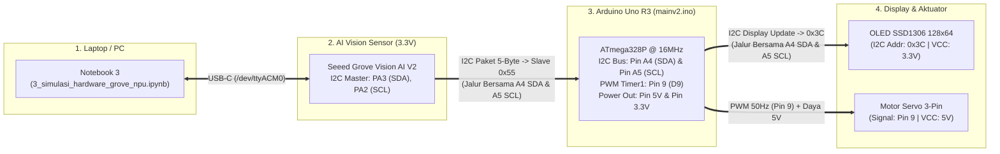

# Rencana Implementasi (`arduino_plan.md`): Migrasi Master Controller ke Arduino Uno R3 (`mainv2.ino`)

Dokumen ini merinci rencana teknis pemindahan seluruh fungsi Master Controller (penerima paket I2C 5-Byte dari **Seeed Grove Vision AI Module V2**, penampil status **OLED SSD1306 128x64**, dan penggerak **Motor Servo 3-Pin** dengan **Cooldown 5 Detik**) dari ESP32-S3 ke **Arduino Uno R3 (`ATmega328P`)** pada file baru:
- **Lokasi File Target**: [`PP2/firmware/mainv2/mainv2.ino`](file:///home/nexus_is/5.Project/Groove-Vision-Ai-v2/PP2/firmware/mainv2/mainv2.ino) *(Telah selesai dibuat & siap di-upload ke Arduino Uno R3)*

---

## 1. Perbandingan Arsitektur: ESP32-S3 vs Arduino Uno R3 (`ATmega328P`)

Memindahkan kode dari ESP32-S3 ke Arduino Uno R3 memerlukan **4 penyesuaian arsitektur penting** agar sistem berjalan 100% stabil:

| Aspek Teknis | ESP32-S3 (`main.ino`) | Arduino Uno R3 (`mainv2.ino`) | Solusi Rekayasa di `mainv2.ino` |
| :--- | :--- | :--- | :--- |
| **Suplai Daya Servo (`5V`)** | Pin `5V` terhalang dioda (`0.7V`), butuh daya luar | Pin **`5V`** langsung terhubung ke `USBVCC` (`5.0V` murni) | Servo langsung dicolok ke pin **`5V`** & **`GND`** Arduino Uno R3 (sudah teruji berhasil). |
| **Driver PWM Servo** | Pembangkit pulsa manual / LEDC di `GPIO 6` | **Hardware Timer1 16-bit (`<Servo.h>`)** di **`Pin 9` (`D9`)** | Menggunakan library bawaan Arduino `<Servo.h>` (`myServo.attach(9, 600, 2300)`) yang bekerja di latar belakang via *Timer1* dengan akurasi `0.5 µs`. |
| **Jumlah Bus I2C** | 2 Bus (`Wire1` Slave `0x55` & `Wire` Master OLED `0x3C`) | **1 Bus Hardware TWI/I2C** pada pin **`A4` (SDA)** & **`A5` (SCL)** | Menggunakan fitur **Multi-Master / Shared Bus TWI AVR** pada `A4` & `A5`: Uno R3 standby sebagai **Slave `0x55`** untuk menerima 5 byte dari Grove, lalu berganti menjadi **Master sementara** saat meng-update layar **OLED `0x3C`**, dan otomatis kembali ke mode Slave `0x55`. |
| **Tegangan Logika I2C** | `3.3V` native | `5.0V` MCU dengan `3.3V` bus I2C | Mematikan *internal pull-up* 5V (`digitalWrite(SDA, LOW); digitalWrite(SCL, LOW);`) dan memberi `VCC` OLED dari pin **`3.3V`** Uno R3 agar jalur `A4/A5` murni ditarik ke **`3.3V`** (aman untuk Grove Vision AI V2 dan tetap terbaca `HIGH` oleh Uno R3). |
| **Kapasitas RAM (`SRAM`)** | `512 KB` (sangat lega) | **`2 KB` (`2.048 Byte`)** — Buffer OLED `128x64` memakai `1.024 Byte` (`50%` RAM) | Menyimpan seluruh teks di memori Flash dengan makro **`F("...")` (`PROGMEM`)** dan menampilkan nilai confidence langsung dari `conf_int` & `conf_dec` tanpa variabel `float` / `sprintf` besar agar pemakaian RAM statis **< 350 Byte** (bebas *stack overflow*). |

---

## 2. Skema Wiring Lengkap pada Arduino Uno R3

### A. Diagram Topologi Bus I2C Tunggal (`A4` & `A5`) + Servo (`Pin 9`)



### B. Tabel Koneksi Pin-ke-Pin (**Arduino Uno R3**)

| Dari Perangkat | Pin / Warna Kabel | Ke Pin **Arduino Uno R3** | Keterangan Penting |
| :--- | :--- | :---: | :--- |
| **Motor Servo 3-Pin** | `Signal PWM` *(Oranye / Kuning)* | **`Pin 9` (`~9`)** | Output PWM Hardware Timer1 (`<Servo.h>`) |
| **Motor Servo 3-Pin** | `VCC` *(Merah)* | **`5V`** | Tegangan `5.0V` langsung dari USB Arduino Uno R3 |
| **Motor Servo 3-Pin** | `GND` *(Coklat / Hitam)* | **`GND`** | Ground Motor Servo |
| **OLED SSD1306 (`0x3C`)** | `SDA` | **`A4`** *(atau pin `SDA`)* | Disatukan di breadboard dengan `SDA` Grove |
| **OLED SSD1306 (`0x3C`)** | `SCL` | **`A5`** *(atau pin `SCL`)* | Disatukan di breadboard dengan `SCL` Grove |
| **OLED SSD1306 (`0x3C`)** | `VCC` | **`3.3V`** | **Gunakan `3.3V`** agar *pull-up* modul OLED tetap di `3.3V` |
| **OLED SSD1306 (`0x3C`)** | `GND` | **`GND`** | Ground Layar OLED |
| **Grove Vision AI V2** | `SDA` *(Putih — Pin `PA3`)* | **`A4`** *(atau pin `SDA`)* | Jalur Data I2C bersama menuju Slave `0x55` |
| **Grove Vision AI V2** | `SCL` *(Kuning — Pin `PA2`)* | **`A5`** *(atau pin `SCL`)* | Jalur Clock I2C bersama (`100 kHz`) |
| **Grove Vision AI V2** | `GND` *(Hitam)* | **`GND`** | **Wajib terhubung (*Common Ground*)** |
| **Grove Vision AI V2** | `VCC` *(Merah — `3.3V`)* | *Tidak Dihubungkan (`NC`)* | Grove sudah mendapat daya dari USB-C sendiri |

---

## 3. Rancangan Struktur Kode `PP2/firmware/mainv2/mainv2.ino`

### A. Konfigurasi Pin & Konstanta
```cpp
#include <Arduino.h>
#include <Wire.h>
#include <Servo.h>
#include <Adafruit_GFX.h>
#include <Adafruit_SSD1306.h>

#define GROVE_I2C_SLAVE_ADDR  0x55    // Alamat I2C Arduino Uno sebagai Slave bagi Grove
#define OLED_I2C_ADDR         0x3C    // Alamat I2C Layar OLED SSD1306
#define SERVO_PIN             9       // Pin PWM Hardware Timer1 Arduino Uno R3

#define SERVO_MIN_US          600     // Batas pulsa aman 0 derajat (us)
#define SERVO_MAX_US          2300    // Batas pulsa aman 180 derajat (us)

#define SERVO_ANGLE_BETINA    0       // 0 derajat   (Kiri  - Betina)
#define SERVO_ANGLE_STANDBY   90      // 90 derajat  (Tengah - Default Standby)
#define SERVO_ANGLE_JANTAN    180     // 180 derajat (Kanan - Jantan)

#define SORT_COOLDOWN_MS      5000UL  // 5 detik Cooldown sebelum kembali ke 90 derajat
#define UNDEF_COOLDOWN_MS     3000UL  // 3 detik Cooldown untuk Undefined
#define ERROR_COOLDOWN_MS     2000UL  // 2 detik Cooldown untuk Error I2C
```

### B. Penanganan Dual-Role I2C (`Slave 0x55` + `Master OLED 0x3C`) yang Aman pada AVR
Pada chip `ATmega328P`, saat `display.display()` selesai mengirim data ke OLED (`0x3C`), kita memastikan modul TWI langsung kembali aktif sebagai **Slave `0x55`** dengan *pull-up* 5V dimatikan:
```cpp
static void restoreI2CSlaveMode()
{
    // Pastikan alamat Slave 0x55 dan interrupt onReceive tetap aktif setelah transaksi Master OLED
    Wire.begin(GROVE_I2C_SLAVE_ADDR);
    Wire.onReceive(onGroveReceive);
    // Matikan internal pull-up 5V pada A4 (SDA) & A5 (SCL) agar bus tetap murni 3.3V
    digitalWrite(SDA, LOW);
    digitalWrite(SCL, LOW);
}
```
* Mengapa ini sangat aman?
  1. Saat menunggu data (`STATE_WAITING_DATA`), Arduino Uno R3 **tidak memanggil `display.display()`** sama sekali, sehingga 100% waktu bus `A4/A5` dalam keadaan diam mendengarkan paket 5-Byte dari Grove Vision AI V2 (`0x55`).
  2. Begitu paket 5-Byte diterima di `onGroveReceive()`, barulah `loop()` menggerakkan servo dan memanggil `renderOledState()`, lalu memanggil `restoreI2CSlaveMode()`.

### C. Alur *State Machine* & Cooldown 5 Detik
1. **Saat Booting (`setup()`)**:
   - Inisialisasi OLED (`0x3C`) dan tampilkan layar `SELF-TEST SERVO...`.
   - Inisialisasi `myServo.attach(SERVO_PIN, SERVO_MIN_US, SERVO_MAX_US)` dan lakukan gerakan uji fisik: **`90°` $\rightarrow$ `0°` $\rightarrow$ `180°` $\rightarrow$ `90°`**.
   - Aktifkan mode Slave `0x55` (`restoreI2CSlaveMode()`) dan masuk ke **State Pertama (`STATE_WAITING_DATA`, Servo `90°`)**.
2. **Saat Menerima Hasil Klasifikasi dari Grove Vision AI V2**:
   - **`class_id == 0` (Betina $\ge 80\%$)**:
     - Servo bergerak ke **`0°`** (`myServo.write(0)`).
     - OLED menampilkan `HASIL : BETINA (HEN)`, nilai `CONF : XX.XX %`, *progress bar*, dan hitung mundur `SERVO: 0 DEG [RST 5s]` $\rightarrow$ `1s`.
     - Selama 5 detik Cooldown, paket I2C baru diabaikan agar gerakan sortir selesai.
     - Setelah **5 detik (`5000 ms`)**, servo otomatis kembali ke **`90°`** dan layar kembali ke `STATUS: WAITING AI...`.
   - **`class_id == 1` (Jantan $\ge 80\%$)**:
     - Servo bergerak ke **`180°`** (`myServo.write(180)`).
     - OLED menampilkan `HASIL : JANTAN (COCK)`, nilai `CONF : XX.XX %`, *progress bar*, dan hitung mundur `SERVO:180 DEG[RST 5s]` $\rightarrow$ `1s`.
     - Setelah **5 detik (`5000 ms`)**, servo otomatis kembali ke **`90°`** dan layar kembali ke `STATUS: WAITING AI...`.
   - **`class_id == 2` (Undefined / Frame Kosong / Confidence $< 80\%$)**:
     - Servo tetap di **`90°`**, OLED menampilkan `UNDEFINED` selama **3 detik**, lalu kembali ke `STATUS: WAITING AI...`.

---

## 4. Langkah Eksekusi (Menunggu Persetujuan Anda)

Setelah Anda menyetujui rencana ini:
1. Saya akan membuat file baru [`PP2/firmware/mainv2/mainv2.ino`](file:///home/nexus_is/5.Project/Groove-Vision-Ai-v2/PP2/firmware/mainv2/mainv2.ino) khusus untuk **Arduino Uno R3** (tanpa menghapus `main.ino` lama milik ESP32-S3).
2. Anda tinggal memilih board **"Arduino Uno"** di Arduino IDE, meng-upload `mainv2.ino`, dan menghubungkan kabel sesuai tabel di atas.

