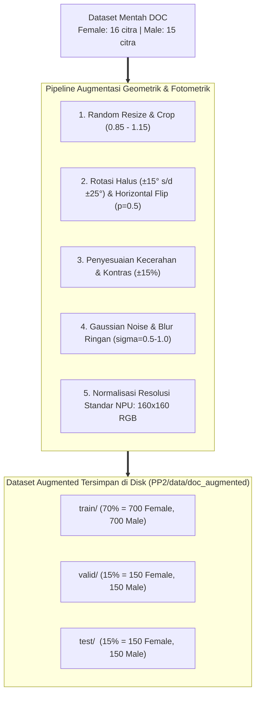
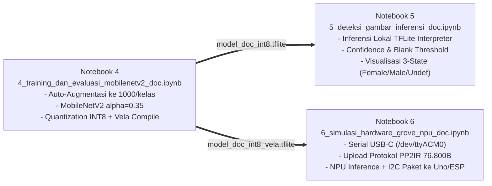

# Konsep & Arsitektur Klasifikasi DOC (*Day-Old Chick*) Sexing AI (`doc_classification.md`)

Dokumen ini memaparkan rancangan teknis menyeluruh untuk implementasi sistem klasifikasi jenis kelamin anak ayam umur sehari (*Day-Old Chick* / DOC) pada arsitektur **TinyML Edge AI** (Grove Vision AI Module V2 + Arm Ethos-U55 NPU + Arduino Uno R3 / ESP32-S3), mentransformasi alur egg-sexing yang sudah berhasil menjadi alur DOC-sexing mandiri.

---

## 1. Analisis Kebutuhan & Kondisi Dataset Awal

### A. Kondisi Dataset Mentah (`PP2/data/doc`)
Dataset saat ini tersimpan di folder `PP2/data/doc` dengan karakteristik:
* **Kelas Female (Betina)**: 16 file citra (`Female01.jpg` s/d `Female16.jpg`), resolusi tinggi (~2.6 – 4.5 MB per citra).
* **Kelas Male (Jantan)**: 15 file citra (`Male01.jpg` s/d `Male14.jpg`, plus duplikat format `Male06(1).jpg`), resolusi tinggi (~2.5 – 3.6 MB per citra).
* **Total Sampel Mentah**: 31 citra.

### B. Tantangan Teknis (*Key Challenges*)
1. **Risiko Overfitting Ekstrem**: 31 citra tidak mencukupi untuk melatih model konvolusi secara langsung tanpa augmentasi masif.
2. **Kebutuhan Kompatibilitas NPU Ethos-U55**: Model harus tetap memenuhi restriksi operator Ethos-U55 (input statis `[1, 160, 160, 3]`, kuantisasi penuh `INT8`, `alpha=0.35`).
3. **Portabilitas Path (Server/Cloud)**: Seluruh notebook dan skrip wajib memakai **relatif path** sehingga tidak bergantung pada direktori spesifik `/home/nexus_is/...`.
4. **Logika Tri-State (Kelas Undefined)**: Sistem harus memiliki ambang batas ketat (*confidence threshold* & *pixel std*) untuk mengembalikan status `UNDEFINED` jika objek tidak jelas atau citra kosong.

---

## 2. Strategi Augmentasi Data (Target: 1.000 Citra per Kelas)

Untuk menghasilkan total **2.000 citra augmented** (1.000 Female dan 1.000 Male), kita menggunakan strategi augmentasi deterministik berbasis Computer Vision (OpenCV / PIL / Albumentations / tf.image).



### Parameter Transformasi Augmentasi:
1. **Flip Horizontal**: `p = 0.5` (simetri alami morfologi bulu/tubuh).
2. **Rotasi Spasial**: `[-20°, +20°]` (meniru variasi sudut peletakan DOC di bawah kamera).
3. **Zoom & Pan**: `scale = [0.85, 1.15]`, `translate = [-10%, +10%]`.
4. **Variasi Pencahayaan**: `brightness_delta = 0.15`, `contrast_range = [0.85, 1.15]` (meniru variasi pencahayaan kandang/lampu sorot).
5. **Color Jitter & Noise**: Sedikit noise Gaussian untuk menjaga kekebalan model terhadap sensor noise kamera industri OV5647.
6. **Penyimpanan Permanen**: File hasil augmentasi disimpan ke disk (`PP2/data/doc_augmented/train`, `valid`, `test`) sehingga training dapat diulang dengan cepat tanpa re-augmentasi dari awal setiap runtime.

---

## 3. Rencana Duplikasi & Spesifikasi Notebook 4 – 6

Notebook 1 – 3 yang sebelumnya digunakan untuk *egg sexing* akan diduplikasi dan disesuaikan secara khusus untuk *DOC sexing* menjadi Notebook 4 – 6:



### A. Notebook 4: `4_training_dan_evaluasi_mobilenetv2_doc.ipynb`
* **Peran**: Pipeline training, evaluasi metrik, kuantisasi INT8, dan kompilasi Vela NPU untuk DOC.
* **Fitur Utama**:
  1. **Deteksi Dataset & Auto-Augmentasi**: Jika folder `PP2/data/doc_augmented` belum ada atau belum mencapai 1.000 citra/kelas, notebook otomatis menjalankan generator augmentasi dan menyimpannya.
  2. **Model Architecture**:
     - Input layer: `(160, 160, 3)`
     - Backbone: `MobileNetV2(input_shape=(160, 160, 3), alpha=0.35, include_top=False, weights='imagenet')`
     - GlobalAveragePooling2D
     - Dropout (0.2)
     - Dense 2 unit (Softmax) dengan pemetaan `0 = Female`, `1 = Male`.
  3. **Training 2 Fase**:
     - *Fase 1 (Warm-up Head)*: Backbone dibekukan, 10 epoch dengan Adam (`lr=1e-3`).
     - *Fase 2 (Fine-Tuning)*: 30 layer teratas backbone dibuka, 20 epoch dengan Adam (`lr=1e-4`).
  4. **Full Integer Quantization (`INT8`)**:
     - Menggunakan representative dataset generator dari data validasi DOC.
     - Input & Output terkuantisasi `int8` (skala & zero-point terekam).
     - Output model: `PP2/model/model_doc_int8.tflite` dan label: `PP2/model/labels_doc.txt`.
  5. **Vela Compiler**:
     - Mengompilasi `model_doc_int8.tflite` dengan target Ethos-U55 (128 MACs) menghasilkan `PP2/model/vela_out/model_doc_int8_vela.tflite`.

### B. Notebook 5: `5_deteksi_gambar_inferensi_doc.ipynb`
* **Peran**: Inferensi lokal dan verifikasi logika keputusan 3-State (*Female, Male, Undefined*) tanpa memerlukan hardware tercolok.
* **Fitur Utama**:
  1. **Dual Thresholding Logic**:
     $$\text{Prediksi} = \begin{cases} 
     \text{Undefined (2)}, & \text{jika } \sigma_{\text{pixel}} < 12.0 \text{ (Frame Kosong)} \\
     \text{Undefined (2)}, & \text{jika } \max(P) < 0.80 \text{ (Ragu-ragu / Low Conf)} \\
     \text{Female (0)}, & \text{jika } P(\text{Female}) \ge 0.80 \\
     \text{Male (1)}, & \text{jika } P(\text{Male}) \ge 0.80 
     \end{cases}$$
  2. **Simulasi Aktuasi Sudut Servo**:
     - `Female` $\rightarrow$ Sudut `0°` (Sortir Kiri)
     - `Male` $\rightarrow$ Sudut `180°` (Sortir Kanan)
     - `Undefined` $\rightarrow$ Sudut `90°` (Tahan / Standby di Tengah)
  3. **Visualisasi Komprehensif**: Menampilkan citra DOC, histogram piksel, bar persentase confidence, dan status keputusan.

### C. Notebook 6: `6_simulasi_hardware_grove_npu_doc.ipynb`
* **Peran**: Pengujian inferensi *on-device* langsung pada chip Seeed Grove Vision AI Module V2 (Cortex-M55 + Ethos-U55) via koneksi serial USB-C (`/dev/ttyACM0`).
* **Fitur Utama**:
  1. Auto-deteksi port serial USB-C (`/dev/ttyACM*`).
  2. Pemilihan citra uji DOC dari folder `test/Female`, `test/Male`, maupun citra kosong / background luar ruangan.
  3. Preprocessing gambar ke format `160x160 RGB uint8` (76.800 byte) dan pengiriman via protokol UART `PP2IR`.
  4. Pembacaan respon JSON inferensi dari Grove NPU (`PP2_JSON`), verifikasi kesesuaian paket I2C 5-Byte ke Arduino/ESP32, dan visualisasi grafik di notebook.

---

## 4. Konsep Standarisasi Path Relatif (*Zero Path Break*)

Untuk mencegah error `FileNotFoundError` saat kode di-upload ke server, virtual machine, atau Google Colab, seluruh skrip dan notebook menerapkan aturan:

1. **Prinsip Root Proyek**:
   Path selalu dihitung relatif terhadap letak notebook atau skrip, menggunakan `pathlib.Path`:
   ```python
   import pathlib

   # Di dalam Notebook:
   NOTEBOOK_DIR = pathlib.Path.cwd()
   BASE_DIR = NOTEBOOK_DIR.parent if NOTEBOOK_DIR.name == "notebook" else NOTEBOOK_DIR
   DATASET_DIR = BASE_DIR / "data" / "doc_augmented"
   MODEL_DIR = BASE_DIR / "model"
   ```
2. **Fallback Otomatis**:
   Jika folder `doc_augmented` belum ada, kode secara otomatis merujuk ke folder mentah `BASE_DIR / "data" / "doc"` untuk memicu generator augmentasi.
3. **Tidak Ada String Statis**:
   Dilarang keras mencantumkan `/home/nexus_is/...` di dalam kode `.py` maupun file `.ipynb`.

---

## 5. Generator Golden Data DOC (`PP2/model/generate_golden_data_doc.py`)

Untuk pengujian mandiri firmware C/C++ pada Grove Vision AI Module V2 tanpa ketergantungan koneksi USB streaming, kita menyediakan skrip generator golden data:
* **Output Target**: File C header `golden_data_doc.h` (atau diintegrasikan ke firmware scenario app).
* **Komposisi 8 Sampel INT8 (Total ~614 KB)**:
  1. **3 Sampel Female**: Citra uji DOC betina dengan probabilitas $P(\text{Female}) \ge 80\%$ (memverifikasi aktuasi `0°`).
  2. **3 Sampel Male**: Citra uji DOC jantan dengan probabilitas $P(\text{Male}) \ge 80\%$ (memverifikasi aktuasi `180°`).
  3. **1 Sampel Blank Frame**: Citra flat/tanpa objek ($\sigma < 12.0$) untuk menguji deteksi frame kosong (`Undefined`, `90°`).
  4. **1 Sampel Ambiguous**: Citra dengan confidence rendah ($\max(P) < 80\%$) untuk menguji penolakan citra ragu-ragu (`Undefined`, `90°`).

---

## 6. Integrasi dengan Firmware Aktuator (Arduino Uno R3 / ESP32-S3)

Paket I2C 5-Byte yang dikirimkan oleh Grove Vision AI V2 ke Arduino Uno R3 (`mainv2.ino`) atau ESP32-S3 (`main.ino`) menggunakan format terpadu:
$$\text{Paket I2C} = [0\text{xAA},\; \text{class\_id},\; \text{conf\_int},\; \text{conf\_dec},\; \text{checksum}]$$

* `class_id = 0`: **Female** $\rightarrow$ Servo `0°`, OLED `BETINA (HEN)`
* `class_id = 1`: **Male** $\rightarrow$ Servo `180°`, OLED `JANTAN (COCK)`
* `class_id = 2`: **Undefined** $\rightarrow$ Servo `90°`, OLED `UNDEFINED`

Dengan demikian, firmware mikrokontroler aktuator yang sudah bekerja stabil pada pengujian sebelumnya dapat langsung digunakan tanpa modifikasi protokol.

---

## 7. Rencana Tahapan Eksekusi Selanjutnya

1. **Langkah 1**: Buat skrip modul augmentasi data [`PP2/data/doc_augmented.py`](file:///home/nexus_is/5.Project/Groove-Vision-Ai-v2/PP2/data/doc_augmented.py) dan generate 1.000 sampel Female & 1.000 sampel Male ke `PP2/data/doc_augmented/`.
2. **Langkah 2**: Buat Notebook 4 (`PP2/notebook/4_training_dan_evaluasi_mobilenetv2_doc.ipynb`), latih model MobileNetV2 INT8 untuk DOC, dan compile dengan Vela.
3. **Langkah 3**: Buat Notebook 5 (`PP2/notebook/5_deteksi_gambar_inferensi_doc.ipynb`) untuk pengujian lokal 3-state.
4. **Langkah 4**: Buat Notebook 6 (`PP2/notebook/6_simulasi_hardware_grove_npu_doc.ipynb`) untuk simulasi hardware via serial.
5. **Langkah 5**: Buat skrip generator golden data `PP2/model/generate_golden_data_doc.py` untuk ekspor sampel C-array INT8.

