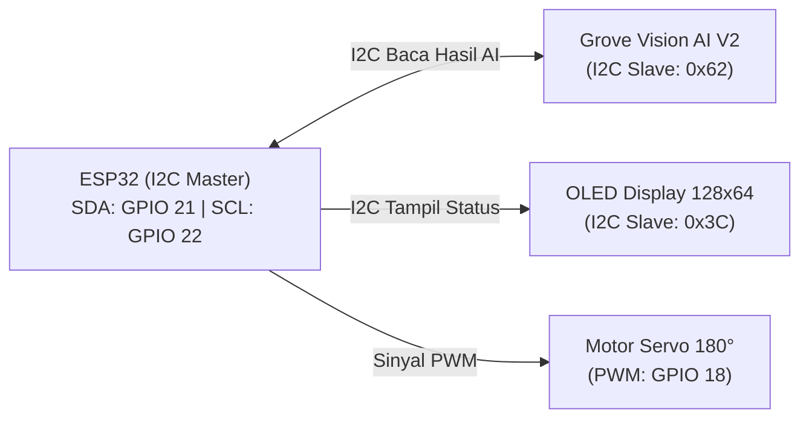
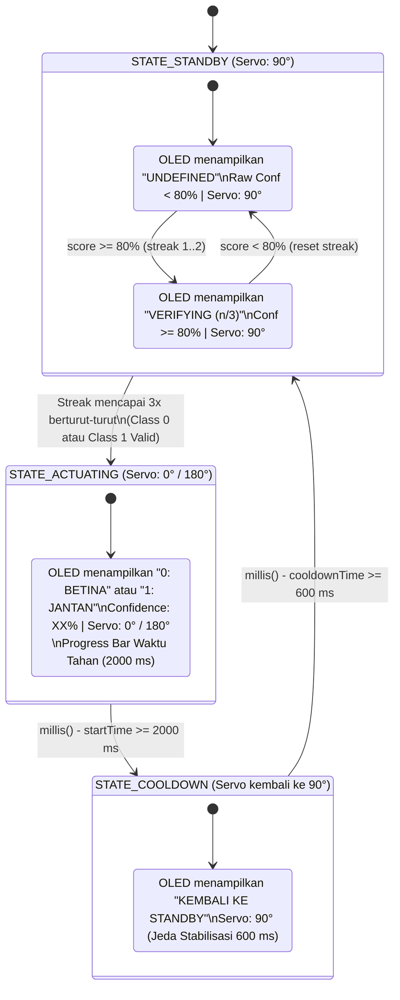

# Konsep Pemrograman ESP32: Komunikasi I2C (Grove Vision AI V2 + OLED) & Kontrol Servo Non-Blocking

## 1. Tujuan Dokumen
Dokumen ini merancang cara kerja program mikrokontroler **ESP32 (`esp32.ino`)** sebagai pengendali utama yang:
1. Membaca hasil inferensi (`class` dan `confidence`) dari **Grove Vision AI V2** melalui **I2C (`0x62`)**.
2. Menerapkan filter *threshold* dan *debouncing* untuk mendeteksi kondisi **`undefined`** (tanpa menambah kelas pada model AI).
3. Menampilkan status sistem, hasil klasifikasi (`0: BETINA`, `1: JANTAN`, atau `UNDEFINED`), nilai *confidence*, dan posisi servo secara *real-time* pada **Layar OLED I2C (`0x3C`)**.
4. Menggerakkan **Motor Servo** secara *non-blocking* (`millis()`).

---

## 2. Topologi Bus I2C Multi-Slave (`Grove Vision AI V2` + `Layar OLED`)
Protokol I2C memungkinkan ESP32 berkomunikasi dengan **Grove Vision AI V2** dan **Layar OLED (SSD1306 128x64)** secara bersamaan hanya menggunakan **2 pin yang sama (`SDA = GPIO 21`, `SCL = GPIO 22`)** karena keduanya memiliki alamat I2C yang berbeda:



---

## 3. Data yang Dikirim Grove Vision AI V2 via I2C (`0x62`)
Agar sangat ringan dan cepat dibaca oleh ESP32, **Grove Vision AI V2** hanya mengirimkan hasil akhir inferensi (bukan gambar mentah). Setiap *polling*, ESP32 hanya membaca **2 variabel integer utama**:

| Nama Variabel di ESP32 | Tipe Data | Rentang Nilai | Keterangan |
| :--- | :--- | :--- | :--- |
| **`target`** (`class_id`) | `uint8_t` (Integer) | `0` atau `1` | **`0`** = Betina (`hen`)<br>**`1`** = Jantan (`cock`) |
| **`score`** (`confidence`) | `uint8_t` (Integer) | `0` – `100` | Tingkat keyakinan prediksi dalam **persen (%)**.<br>Contoh: `87` berarti *confidence* **87%**. |

### Contoh Cara ESP32 Membacanya:
Dengan library `Seeed_Arduino_SSCMA`, ESP32 cukup memanggil `AI.invoke()` lalu mengambil nilai:
```cpp
int class_id   = AI.classes()[0].target; // Bernilai 0 atau 1
int confidence = AI.classes()[0].score;  // Bernilai 0 - 100 (%)
```
*(Catatan: Jika menggunakan custom firmware C++ `EPII_CM55M_APP_S` tanpa SSCMA, pembacaan via `Wire.requestFrom(0x62, 2)` juga hanya mengambil 2 Byte: `Byte[0] = class_id`, `Byte[1] = confidence`).*

---

## 4. Strategi Deteksi `undefined` Hanya dengan Threshold (Tanpa Menambah Kelas Model)
Model MobileNetV2 tetap dipertahankan **2 kelas murni (`0: Betina`, `1: Jantan`)** agar beban komputasi NPU tetap paling ringan. Untuk mendeteksi gambar kosong (tidak ada ayam) sebagai **`UNDEFINED`**, ESP32 menerapkan **2 Lapis Filter Logika**:

1. **Lapis 1 – Confidence Threshold (`CONFIDENCE_THRESHOLD = 80`):**
   * Jika **`score < 80`** $\rightarrow$ Hasil klasifikasi langsung ditetapkan sebagai **`UNDEFINED`** (abaikan `class_id`).
2. **Lapis 2 – Consecutive Frame Filter / Debouncing (`REQUIRED_STREAK = 3`):**
   * Saat kamera menyorot ruang kosong, prediksi model biner kadang melonjak sesaat (*false spike*) di atas 80% selama 1 *frame*.
   * ESP32 menghitung `streak_count`: Servo dan status hasil klasifikasi hanya akan berubah menjadi **`CLASS 0 (BETINA)`** atau **`CLASS 1 (JANTAN)`** jika kelas yang sama terdeteksi dengan **`score >= 80%` sebanyak minimal 3 kali berturut-turut**.
   * Jika belum mencapai 3 kali berturut-turut atau `score` turun di bawah 80%, status tetap **`UNDEFINED`**.

### Tabel Keputusan Klasifikasi di ESP32:
| Kondisi Pembacaan I2C dari Grove Vision | Status Klasifikasi (OLED & Serial) | Posisi Target Servo |
| :--- | :--- | :--- |
| Tidak ada data / `score < 80%` | **`UNDEFINED`** | **`90°` (Standby)** |
| `score >= 80%`, tapi belum konsisten 3x (`streak < 3`) | **`UNDEFINED (Verifying 1/3..2/3)`** | **`90°` (Standby)** |
| `target == 0` & `score >= 80%` (Konsisten $\ge 3\times$) | **`0 : BETINA`** | **`0°` (Jalur Betina)** |
| `target == 1` & `score >= 80%` (Konsisten $\ge 3\times$) | **`1 : JANTAN`** | **`180°` (Jalur Jantan)** |

---

## 5. Arsitektur State Machine Terpadu (Servo + Display OLED)
Kontrol **Motor Servo** dan **Layar OLED** berjalan secara sinkron di dalam satu **Finite State Machine (FSM)** berbasis `millis()` (tanpa `delay()`):



### Detail Tampilan Layar OLED (`128x64` Piksel) di Setiap State:

#### A. `STATE_STANDBY` – Kondisi `UNDEFINED` (Kamera Menyorot Ruang Kosong)
Ketika tidak ada ayam (atau `score < 80%`), layar OLED menampilkan:
```text
+----------------------------+
| DOC SEXING AI     [STANDBY]|
|----------------------------|
|   STATUS : UNDEFINED       |
|                            |
| Raw Score: 52% (< 80%)     |
| Servo Pos: 90 deg (Center) |
+----------------------------+
```
*(Jika `score >= 80%` namun baru 1 atau 2 frame berturut-turut, baris tengah menampilkan `VERIFYING... (1/3)` atau `(2/3)`).*

#### B. `STATE_ACTUATING` – Kondisi Terdeteksi Valid (`0: BETINA` atau `1: JANTAN`)
Begitu mencapai 3x berturut-turut dengan `score >= 80%`, servo bergerak ke `0°` (Betina) atau `180°` (Jantan) dan layar OLED terkunci menampilkan hasil keputusan selama 2 detik:
```text
+----------------------------+
| HASIL DETEKSI     [SORTING]|
|----------------------------|
|  >> 0 : BETINA <<          |  <-- (Atau ">> 1 : JANTAN <<")
|                            |
| Confidence : 93%           |
| Servo Pos  : 0 deg  [==== ]|
+----------------------------+
```

#### C. `STATE_COOLDOWN` – Kondisi Reset Kembali ke `90°`
Saat waktu tahan 2 detik selesai, servo kembali ke `90°` selama `600 ms` agar mekanik stabil sebelum membaca objek baru:
```text
+----------------------------+
| DOC SEXING AI    [COOLDOWN]|
|----------------------------|
|     RESETTING SERVO...     |
|     KEMBALI KE 90 DEG      |
|                            |
| Servo Pos: 90 deg (Center) |
+----------------------------+
```

### Optimasi Refresh OLED (Non-Blocking)
* Fungsi `display.display()` pada OLED I2C membutuhkan waktu sekitar `~15-20 ms`.
* Agar tidak memperlambat pembacaan I2C dari Grove Vision AI V2, layar OLED **hanya di-update jika**:
  1. Terjadi perpindahan *State* (misal dari `STANDBY` ke `ACTUATING` langsung di-update seketika), atau
  2. Sudah melewati interval `OLED_REFRESH_INTERVAL_MS = 200 ms` sejak update layar terakhir.

---

## 6. Konfigurasi Pin & Library Hardware

### Tabel Pinout Wiring:
| Komponen | Pin Komponen | Pin ESP32 | Alamat / Keterangan |
| :--- | :--- | :--- | :--- |
| **Grove Vision AI V2** | `SDA` | **`GPIO 21`** | I2C Slave Address: **`0x62`** |
| **Grove Vision AI V2** | `SCL` | **`GPIO 22`** | Terhubung paralel dengan SCL OLED |
| **Grove Vision AI V2** | `VCC` & `GND` | `3.3V / 5V` & `GND` | Common Ground dengan ESP32 |
| **OLED Display 0.96" (SSD1306)** | `SDA` | **`GPIO 21`** | I2C Slave Address: **`0x3C`** |
| **OLED Display 0.96" (SSD1306)** | `SCL` | **`GPIO 22`** | Terhubung paralel dengan SCL Grove Vision |
| **OLED Display 0.96" (SSD1306)** | `VCC` & `GND` | `3.3V` & `GND` | Catu daya langsung dari pin 3.3V ESP32 |
| **Motor Servo (180°)** | `Signal (PWM)` | **`GPIO 18`** | Sinyal kontrol sudut `0°`, `90°`, `180°` |
| **Motor Servo (180°)** | `VCC` & `GND` | `5V Eksternal` & `GND` | Gunakan sumber 5V stabil & satukan `GND` ke ESP32 |

### Library Arduino yang Digunakan di ESP32:
1. `Wire.h` (Bawaan ESP32 untuk komunikasi I2C Master).
2. `Seeed_Arduino_SSCMA.h` (Membaca `target` dan `score` dari Grove Vision AI V2).
3. `Adafruit_GFX.h` & `Adafruit_SSD1306.h` (Menampilkan teks dan grafik di layar OLED `128x64`).
4. `ESP32Servo.h` (Mengendalikan PWM Motor Servo pada ESP32).
