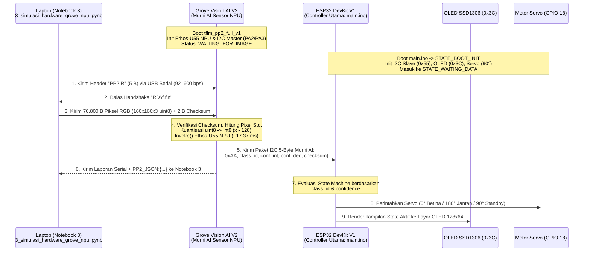
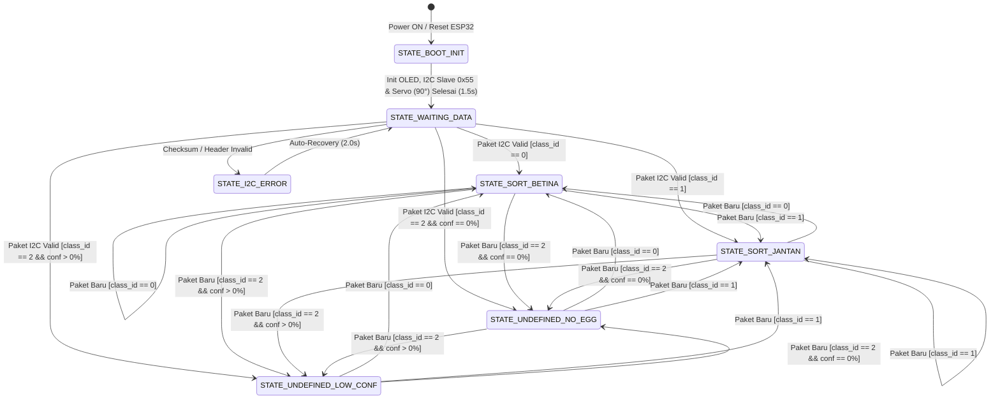
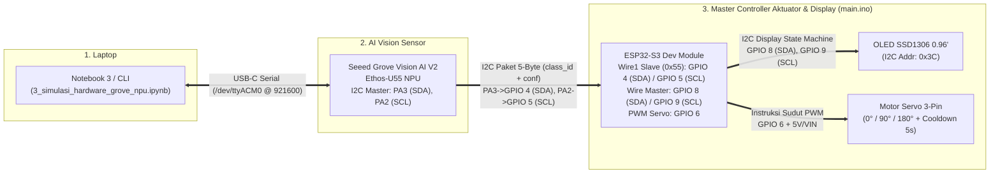

# Rencana Implementasi `tflm_pp2_full_v1`, Notebook Pengirim Gambar, dan Firmware ESP32 (`main.ino`)

Dokumen ini merinci rencana arsitektur, protokol komunikasi data, pembagian peran antar-perangkat (**Laptop Jupyter Notebook $\rightarrow$ Grove Vision AI V2 $\rightarrow$ ESP32 $\rightarrow$ OLED & Servo**), *State Machine* tampilan OLED beserta aktuasi Servo di ESP32, skema wiring perangkat keras, serta daftar file yang akan dibuat/dimodifikasi.

---

## 1. Tujuan & Pembagian Peran Sistem (*Strict Separation of Concerns*)

Sistem dirancang menjadi **3 komponen terpisah** dengan batasan tanggung jawab yang tegas:

1. **Laptop — Notebook Khusus Pengirim Gambar ([`PP2/notebook/3_simulasi_hardware_grove_npu.ipynb`](../notebook/3_simulasi_hardware_grove_npu.ipynb))**:
   - Notebook baru (terpisah dari [`2_deteksi_gambar_inferensi.ipynb`](../notebook/2_deteksi_gambar_inferensi.ipynb)) yang khusus bertugas membaca file gambar dari laptop (`test/hen`, `test/cock`, `valid/`, atau citra kosong `undefined`), mengubah ukurannya menjadi `160×160 RGB uint8`, dan mengirimkannya melalui **USB-C Serial (`/dev/ttyACM0` @ `921600` baud)** ke Grove Vision AI V2.
   - Menerima balasan laporan NPU (`PP2_JSON:{...}`) dari Grove Vision AI V2 untuk memvisualisasikan hasil klasifikasi dan performa hardware NPU di layar laptop.

2. **Seeed Grove Vision AI Module V2 — Murni *AI Vision Sensor* (`tflm_pp2_full_v1`)**:
   - Menerima `76,800 byte` piksel gambar `160×160×3` dari Notebook 3 via USB-UART.
   - Menghitung standar deviasi kontras piksel (`pixel_std`), melakukan kuantisasi `uint8 -> int8` on-device, dan mengeksekusi model **`model_int8_vela.tflite`** di akselerator **Arm Ethos-U55 NPU**.
   - **Hanya mengirimkan data hasil klasifikasi (`class_id`: `0`, `1`, atau `2`) dan nilai `confidence` (`conf_int`, `conf_dec`) dalam paket I2C 5-Byte ke ESP32 (`Slave 0x55`)**, serta mencetak log/JSON kembali ke Notebook 3 di laptop.
   - **Tidak** mengambil keputusan sudut Servo, **tidak** menginisialisasi kamera `OV5647`, dan **tidak** mengontrol OLED.

3. **ESP32 DevKit V1 — *Master Controller* Aktuator Servo & Layar OLED ([`PP2/firmware/main.ino`](../firmware/main.ino))**:
   - **Seluruh instruksi perangkat keras hilir (keputusan sudut Servo & tampilan layar OLED) dikomandoi 100% oleh ESP32.**
   - Menerima paket data 5-Byte (`class_id` + `confidence`) dari Grove Vision AI V2 melalui antarmuka **I2C Slave (`0x55`)**.
   - Menjalankan **State Machine** untuk menerjemahkan `class_id` dan `confidence` menjadi:
     1. **Instruksi Sudut Motor Servo (`GPIO 18`)**: Memutuskan apakah Servo bergerak ke jalur Betina (`0°`), jalur Jantan (`180°`), atau posisi Standby/Tolak (`90°`).
     2. **Instruksi Render Layar OLED SSD1306 128×64 (`0x3C`)**: Menampilkan layar sesuai *state* aktif (Booting, Menunggu Data, Betina, Jantan, Undefined Frame Kosong, atau Undefined Confidence Rendah).

---

## 2. Alur Kerja & Protokol Komunikasi Antar-Perangkat



### A. Protokol USB-UART: `Notebook 3 (Laptop) <-> Grove Vision AI V2` (`921600 bps, 8N1`)

| Tahap | Arah | Format Paket | Ukuran | Keterangan |
| :-: | :-: | :--- | :-: | :--- |
| **1** | `Notebook -> Grove` | `"PP2IR"` (`0x50 0x50 0x32 0x49 0x52`) | `5 B` | Command memulai upload gambar `160×160×3` RGB `uint8`. |
| **2** | `Grove -> Notebook` | `"RDY\r\n"` | `5 B` | Handshake bahwa buffer tensor Grove siap menerima data. |
| **3** | `Notebook -> Grove` | `rgb_bytes[76800]` + `checksum_u16` | `76,802 B` | `76,800 byte` piksel RGB diikuti `2 byte` checksum (`sum(rgb_bytes) & 0xFFFF`, *little-endian*). |
| **4** | `Grove -> Notebook` | Log Tabel + `PP2_JSON:{...}\r\n` | Variabel | Ringkasan hasil inferensi NPU & metrik siklus PMU untuk divisualisasikan di Notebook 3. |

### B. Protokol I2C (5 Byte Murni Data AI): `Grove Vision AI V2 (Master) -> ESP32 (Slave 0x55)` (`100 kHz`)

Setiap kali inferensi di Ethos-U55 NPU selesai, Grove Vision AI V2 **hanya mengirim hasil klasifikasi dan konfidensinya** sebanyak **5 Byte** melalui fungsi `hx_drv_i2cm_write_data(USE_DW_IIC_0, 0x55, NULL, 0, pkt, 5)` ke ESP32:

| Indeks Byte | Nama Field | Tipe Data | Nilai / Rentang | Keterangan |
| :-: | :--- | :-: | :--- | :--- |
| **`Byte 0`** | `header` | `uint8_t` | `0xAA` | Byte sinkronisasi awal paket (*Start-of-Packet*). |
| **`Byte 1`** | `class_id` | `uint8_t` | `0`, `1`, atau `2` | Hasil klasifikasi AI: `0` = **Betina (`hen`)**, `1` = **Jantan (`cock`)**, `2` = **Undefined** |
| **`Byte 2`** | `conf_int` | `uint8_t` | `0 .. 100` | Bagian bilangan bulat dari persentase *confidence* (misal `99` untuk `99.61%`). |
| **`Byte 3`** | `conf_dec` | `uint8_t` | `0 .. 99` | Bagian 2 angka desimal dari persentase *confidence* (misal `61` untuk `99.61%`). |
| **`Byte 4`** | `checksum` | `uint8_t` | `0x00 .. 0xFF` | XOR Checksum: `Byte0 ^ Byte1 ^ Byte2 ^ Byte3` untuk validasi integritas data di ESP32. |

### Contoh Paket 5-Byte untuk Setiap Kondisi:
1. **Terdeteksi Betina (`99.61%`)**:
   - Paket I2C: `[0xAA, 0, 99, 61, 0xF4]` $\rightarrow$ ESP32 membaca `class_id = 0`, `conf = 99.61%`.
2. **Terdeteksi Jantan (`98.82%`)**:
   - Paket I2C: `[0xAA, 1, 98, 82, 0x9B]` $\rightarrow$ ESP32 membaca `class_id = 1`, `conf = 98.82%`.
3. **Terdeteksi Undefined — Gambar Kosong/Polos (`pixel_std < 12.0`)**:
   - Paket I2C: `[0xAA, 2, 0, 0, 0xA8]` $\rightarrow$ ESP32 membaca `class_id = 2`, `conf = 0.00%` (menandakan tidak ada telur / frame kosong).
4. **Terdeteksi Undefined — Ragu-ragu / Confidence Rendah (`62.45% < 80%`)**:
   - Paket I2C: `[0xAA, 2, 62, 45, 0xB9]` $\rightarrow$ ESP32 membaca `class_id = 2`, `conf = 62.45%` (menandakan objek ada namun *confidence* di bawah ambang `80%`).

---

## 3. State Machine Aktuasi Servo & Tampilan OLED di ESP32 ([`PP2/firmware/main.ino`](../firmware/main.ino))

Di dalam [`PP2/firmware/main.ino`](../firmware/main.ino), ESP32 menjalankan *State Machine* penuh yang mengatur pergerakan **Motor Servo (`GPIO 18`)** dan merender **Layar OLED SSD1306 (`128×64`, `0x3C`)**.

### A. Diagram State Machine ESP32 (`main.ino`)



### B. Tabel Transisi State, Aksi Servo, & Informasi OLED di ESP32

| Nama State (`esp_state_t`) | Pemicu Masuk State (*Trigger*) | Perintah Servo oleh ESP32 | Ringkasan Tampilan Layar OLED (`128×64`) |
| :--- | :--- | :---: | :--- |
| **`STATE_BOOT_INIT`** | ESP32 baru dinyalakan / di-reset (`setup()`) | `servo.write(90)` *(Kalibrasi Tengah)* | Splash screen inisialisasi sistem, alamat I2C `0x55`, dan posisi awal Servo `90°`. |
| **`STATE_WAITING_DATA`** | Selesai *booting* (`1.5 detik`) & belum ada paket I2C dari Grove | `90°` *(Standby)* | Menampilkan status **`READY / WAITING`** menunggu kiriman hasil klasifikasi dari Grove Vision AI V2. |
| **`STATE_SORT_BETINA`** | Paket I2C valid dengan **`class_id == 0`** | **`servo.write(0)`** *(0° — Sortir Kiri)* | Menampilkan hasil **`BETINA (HEN)`**, nilai `Confidence %`, *progress bar* penuh, dan status **`SERVO: 0 DEG (KIRI)`**. |
| **`STATE_SORT_JANTAN`** | Paket I2C valid dengan **`class_id == 1`** | **`servo.write(180)`** *(180° — Sortir Kanan)* | Menampilkan hasil **`JANTAN (COCK)`**, nilai `Confidence %`, *progress bar* penuh, dan status **`SERVO: 180 DEG (KANAN)`**. |
| **`STATE_UNDEFINED_NO_EGG`** | Paket I2C valid dengan **`class_id == 2`** dan **`conf == 0.00%`** | **`servo.write(90)`** *(90° — Standby)* | Menampilkan **`UNDEFINED (NO EGG)`**, `CONF: 0.00%`, *progress bar* kosong, dan status **`SERVO: 90 DEG (HOLD)`**. |
| **`STATE_UNDEFINED_LOW_CONF`** | Paket I2C valid dengan **`class_id == 2`** dan **`conf > 0.00%`** | **`servo.write(90)`** *(90° — Standby)* | Menampilkan **`UNDEFINED (RAGU)`**, nilai `CONF: xx.xx% (<80%)`, *progress bar* parsial, dan status **`SERVO: 90 DEG (HOLD)`**. |
| **`STATE_I2C_ERROR`** | Paket I2C diterima tetapi `header != 0xAA` atau `checksum` salah | Tetap di sudut aman **`90°`** | Menampilkan peringatan **`I2C PACKET ERROR`** selama `2 detik` sebelum kembali ke `STATE_WAITING_DATA`. |

---

### C. Desain Lengkap Tampilan Layar OLED SSD1306 (`128×64` Piksel) untuk Setiap State

Layar OLED `128×64` dibagi menjadi 4 zona vertikal agar terbaca jelas dari jarak pandang praktikum:
- **Baris Atas (`Y = 0..11`)**: *Header Banner* (nama sistem + penghitung paket `#001`).
- **Baris Utama (`Y = 14..28`)**: Label Keputusan Klasifikasi (`BETINA`, `JANTAN`, `UNDEFINED`, atau `WAITING`).
- **Baris Confidence & Progress Bar (`Y = 31..51`)**: Nilai numerik `CONF: xx.xx%` dilengkapi kotak *Progress Bar* (`120×8 px`) + garis penanda batas ambang `80%` pada piksel ke-96.
- **Baris Bawah (`Y = 54..63`)**: Status instruksi sudut Servo yang sedang dieksekusi oleh ESP32.

````carousel
```text
+----------------------------------+
|     PP2 EGG SEXING CONTROLLER    |
|==================================|
|                                  |
|       INITIALIZING SYSTEM...     |
|    I2C Slave : 0x55 (GPIO 25/26) |
|    OLED Bus  : 0x3C (GPIO 21/22) |
|    Servo PWM : 90 DEG (GPIO 18)  |
+----------------------------------+
       [1] STATE_BOOT_INIT
```
<!-- slide -->
```text
+----------------------------------+
| PP2 EGG SEXING AI         [#000] |
|----------------------------------|
| STATUS : WAITING GROVE AI...     |
| CONF   : --.-- %                 |
| [                        |     ] |
| SERVO  : 90 DEG (STANDBY)        |
+----------------------------------+
      [2] STATE_WAITING_DATA
```
<!-- slide -->
```text
+----------------------------------+
| PP2 EGG SEXING AI         [#001] |
|----------------------------------|
| HASIL  : BETINA (HEN)            |
| CONF   : 99.61 %                 |
| [########################|#####] |
| SERVO  : 0 DEG (SORTIR KIRI)     |
+----------------------------------+
       [3] STATE_SORT_BETINA
```
<!-- slide -->
```text
+----------------------------------+
| PP2 EGG SEXING AI         [#002] |
|----------------------------------|
| HASIL  : JANTAN (COCK)           |
| CONF   : 98.82 %                 |
| [########################|#### ] |
| SERVO  : 180 DEG (SORTIR KANAN)  |
+----------------------------------+
       [4] STATE_SORT_JANTAN
```
<!-- slide -->
```text
+----------------------------------+
| PP2 EGG SEXING AI         [#003] |
|----------------------------------|
| HASIL  : UNDEFINED (NO EGG)      |
| CONF   : 0.00 % (BLANK FRAME)    |
| [                        |     ] |
| SERVO  : 90 DEG (STANDBY/HOLD)   |
+----------------------------------+
    [5] STATE_UNDEFINED_NO_EGG
```
<!-- slide -->
```text
+----------------------------------+
| PP2 EGG SEXING AI         [#004] |
|----------------------------------|
| HASIL  : UNDEFINED (LOW <80%)    |
| CONF   : 62.45 % (RAGU-RAGU)     |
| [###############         |     ] |
| SERVO  : 90 DEG (STANDBY/HOLD)   |
+----------------------------------+
   [6] STATE_UNDEFINED_LOW_CONF
```
````

> [!NOTE]
> Garis vertikal `|` pada *progress bar* OLED di posisi 80% (`X = 100`) berfungsi sebagai indikator visual ambang batas (*threshold* `80%`). Jika bar melewati garis `|`, telur diklasifikasikan sebagai **Betina (`0°`)** atau **Jantan (`180°`)**; jika berhenti di sebelah kiri garis `|`, ESP32 menahan Servo di **`90°` (`UNDEFINED`)**.

---

## 4. Rencana Desain Notebook ke-3 ([`PP2/notebook/3_simulasi_hardware_grove_npu.ipynb`](../notebook/3_simulasi_hardware_grove_npu.ipynb))

Notebook ke-3 akan memiliki struktur sel yang rapi dan interaktif, terdiri dari:

1. **Sel 1 — Konfigurasi Koneksi Serial & Pemeriksaan Board (`PING`)**:
   - Membuka koneksi `/dev/ttyACM0` @ `921600` baud dan memastikan Grove Vision AI V2 siap menerima gambar (`READY`).
2. **Sel 2 — Fungsi Inti `send_image_to_grove_npu(image_path)`**:
   - Membaca file gambar dari laptop, me-resize ke `160×160 RGB`, mengirim `"PP2IR"` + `76,800 byte` + `checksum`, lalu menangkap respons `PP2_JSON:{...}` dari Grove Vision AI V2.
   - Menampilkan **2 Panel Visualisasi Matplotlib**:
     - **Panel Kiri**: Gambar input yang dikirim ke Grove beserta info `Pixel Std`.
     - **Panel Kanan**: Grafik bar probabilitas `Betina (hen)` vs `Jantan (cock)` dari **Ethos-U55 NPU**, rincian **paket I2C 5-Byte** (`[0xAA, class_id, conf_int, conf_dec, crc]`) yang dikirim Grove ke ESP32, serta waktu eksekusi NPU (`ms` & `FPS`).
3. **Sel 3 — Uji Kirim Gambar Tunggal (Interaktif)**:
   - Pengguna dapat memilih path gambar mana saja dari folder `test/hen`, `test/cock`, atau `valid/` untuk melihat transisi *State Machine* OLED dan gerakan Servo di ESP32 secara langsung.
4. **Sel 4 — Uji Batch Otomatis Semua State (`Betina` $\rightarrow$ `Jantan` $\rightarrow$ `Undefined Blank` $\rightarrow$ `Undefined Low-Conf`)**:
   - Mengirimkan rangkaian gambar secara otomatis dengan jeda `3 detik` per gambar agar pengguna dapat mengamati perubahan seluruh *state* pada layar OLED dan gerakan Servo (`0°`, `180°`, `90°`), ditutup dengan tabel rekapitulasi hasil pengujian.

---

## 5. Skema Wiring & Koneksi Hardware (`Grove Vision AI V2` + `ESP32-S3 Dev Module` + `OLED` + `Servo`)

> [!IMPORTANT]
> Pada board **ESP32-S3 Dev Module (`ESP32-S3-DevKitC-1`)**, pin `GPIO 22..25` **tidak ada**, dan `GPIO 26..32` digunakan secara internal oleh SPI Flash/PSRAM. Oleh karena itu, konfigurasi pin telah disesuaikan ke pin hardware **ESP32-S3** yang aman dan bebas konflik:
> - **Bus `Wire1` (I2C Slave `0x55` dari Grove Vision AI V2)**: `SDA = GPIO 4`, `SCL = GPIO 5`
> - **Bus `Wire` (I2C Master default ESP32-S3 ke OLED `0x3C`)**: `SDA = GPIO 8`, `SCL = GPIO 9`
> - **Motor Servo (3-Pin)**: `Signal PWM = GPIO 6` (tepat di sebelah `GPIO 5`), `VCC = 5V / VIN`, `GND = GND`

### A. Diagram Topologi Sistem



### B. Skema Rangkaian Kabel (*Pin-to-Pin Wiring Diagram* — ESP32-S3 Dev Module)

```text
  +------------------------+                  +----------------------------------+
  |     LAPTOP / PC        |   Kabel USB-C    |    SEEED GROVE VISION AI V2      |
  |  (Notebook 3 / CLI)    | <==============> |    (/dev/ttyACM0 @ 921600 bps)   |
  +------------------------+                  |                                  |
                                              |  [Konektor Grove I2C 4-Pin]      |
                                              |   1. SCL (Kuning) [Pin PA2] -----+---+
                                              |   2. SDA (Putih)  [Pin PA3] -----+-+ |
                                              |   3. VCC (Merah)  [3.3V] (NC)    | | |
                                              |   4. GND (Hitam)  [GND] ---------+---+-+
                                              +----------------------------------+ | | |
                                                                                   | | |
                                              +----------------------------------+ | | |
                                              |      ESP32-S3 DEV MODULE         | | | |
                                              |   (PP2/firmware/main/main.ino)   | | | |
                                              |----------------------------------| | | |
                                              | [Bus I2C_1: Slave 0x55 dr Grove] | | | |
                                              |  GPIO 4  (I2C1_SDA) <------------+ | | |
                                              |  GPIO 5  (I2C1_SCL) <--------------+ | |
                                              |  GND <-------------------------------+ |
                                              |                                  |     |
                                              | [Bus I2C_0: Master ke OLED 0x3C] |     |
   +------------------------------+           |  GPIO 8  (I2C0_SDA) -------------+--+  |
   |   OLED 0.96" SSD1306 (0x3C)  |           |  GPIO 9  (I2C0_SCL) -------------+--+--+--+
   |------------------------------|           |  3V3 ----------------------------+--+--+  |
   | SDA <------------------------+-----------+                                  |  |  |  |
   | SCL <------------------------+----------------------------------------------+--+--+--+
   | VCC <------------------------+----------------------------------------------+--+  |
   | GND <------------------------+-----------+  GND ----------------------------+-----+
   +------------------------------+           |                                  |
                                              | [Output PWM & Daya Motor Servo]  |
   +------------------------------+           |  GPIO 6  (PWM Signal) -----------+--> [1. Oranye/Kuning : Signal PWM]
   |   MOTOR SERVO (SG90/MG90S)   |           |  5V / VIN (5V USB/Eksternal) ----+--> [2. Merah         : VCC 5V]
   |  0° Betina | 90° | 180° Jantan|          |  GND ----------------------------+--> [3. Coklat/Hitam  : GND]
   +------------------------------+           +----------------------------------+
```

### C. Tabel Pemetaan Pin Lengkap (*Pinout Mapping* — ESP32-S3 Dev Module)

| Dari Perangkat | Pin / Warna Kabel | Ke Pin **ESP32-S3 Dev Module** | Fungsi & Catatan Teknis |
| :--- | :--- | :---: | :--- |
| **Grove Vision AI V2** | `SDA` *(Kabel Putih - Pin `PA3`)* | **`GPIO 4`** | Jalur Data `Wire1` (ESP32-S3 sebagai I2C Slave `0x55`) |
| **Grove Vision AI V2** | `SCL` *(Kabel Kuning - Pin `PA2`)* | **`GPIO 5`** | Jalur Clock `Wire1` (`100 kHz`) |
| **Grove Vision AI V2** | `GND` *(Kabel Hitam)* | **`GND`** | **Wajib terhubung (*Common Ground*)** antara Grove dan ESP32-S3 |
| **Grove Vision AI V2** | `VCC` *(Kabel Merah - `3.3V`)* | *Tidak Dihubungkan (NC)* | Karena Grove dan ESP32-S3 masing-masing mendapat daya dari USB, `VCC` tidak perlu digabung |
| **OLED SSD1306 (`0x3C`)** | `SDA` | **`GPIO 8`** | Jalur Data `Wire` (I2C Master default ESP32-S3 ke OLED) |
| **OLED SSD1306 (`0x3C`)** | `SCL` | **`GPIO 9`** | Jalur Clock `Wire` (I2C Master default ESP32-S3 ke OLED) |
| **OLED SSD1306 (`0x3C`)** | `VCC` | **`3V3`** | Suplai daya `3.3V` dari ESP32-S3 |
| **OLED SSD1306 (`0x3C`)** | `GND` | **`GND`** | Ground layar OLED ke `GND` ESP32-S3 |
| **Motor Servo (`180°`)** | `Pin 1: Signal PWM` *(Oranye / Kuning)* | **`GPIO 6`** | Sinyal PWM Hardware LEDC (`0°`, `90°`, `180°` + Cooldown 5 detik) |
| **Motor Servo (`180°`)** | `Pin 2: VCC` *(Merah)* | **`5V` / `VIN`** | Suplai daya `5V` (jangan dihubungkan ke `3V3` agar ESP32-S3 tidak *brownout reset*) |
| **Motor Servo (`180°`)** | `Pin 3: GND` *(Coklat / Hitam)* | **`GND`** | Ground Motor Servo ke `GND` ESP32-S3 |

---

## 6. Rencana File yang Akan Dibuat / Dimodifikasi

| No | File Target | Aksi | Deskripsi |
| :-: | :--- | :-: | :--- |
| **1** | `EPII_CM55M_APP_S/app/scenario_app/tflm_pp2_full_v1/TFLM_mb_cls_S_only.ld` | **Edit** | Memastikan penempatan simbol `__mm_start_addr__` di akhir `.algo` agar Tensor Arena `450 KB` aman dari variabel BSS. |
| **2** | `EPII_CM55M_APP_S/app/scenario_app/tflm_pp2_full_v1/tflm_mb_cls.c` | **Edit** | Menonaktifkan inisialisasi kamera `OV5647` (`app_start_state`) dan langsung memanggil `cv_mb_cls_init()` serta loop `cv_mb_cls_run()`. |
| **3** | `EPII_CM55M_APP_S/app/scenario_app/tflm_pp2_full_v1/cvapp_mb_cls.cpp` | **Edit** | Mengimplementasikan penerima gambar via UART0 (`PP2IR` + `76,800 B` + `checksum`), perhitungan `pixel_std`, kuantisasi `uint8 -> int8`, inferensi Ethos-U55 NPU, pengiriman **paket I2C 5-Byte murni AI (`[0xAA, class_id, conf_int, conf_dec, checksum]`)** ke ESP32 (`0x55`), serta output `PP2_JSON:{...}` ke Notebook 3. |
| **4** | `EPII_CM55M_APP_S/makefile` | **Edit** | Mengatur `APP_TYPE = tflm_pp2_full_v1`. |
| **5** | `PP2/notebook/3_simulasi_hardware_grove_npu.ipynb` | **Buat Baru** | Notebook ke-3 khusus untuk mengirim gambar manual / *batch* dari laptop ke Grove Vision AI V2 via USB Serial dan memvisualisasikan hasil inferensi NPU beserta paket I2C 5-Byte yang dikirim ke ESP32. |
| **6** | `PP2/firmware/main.ino` | **Buat Baru** | Kode firmware Arduino ESP32 yang membaca paket I2C 5-Byte dari Grove Vision AI V2 (`Wire1` Slave `0x55` di `GPIO 25/26`), menjalankan *State Machine* untuk memutuskan sudut **Motor Servo (`GPIO 18`)**, dan merender tampilan setiap *state* di layar **OLED SSD1306 (`0x3C` di `GPIO 21/22`)**. |
