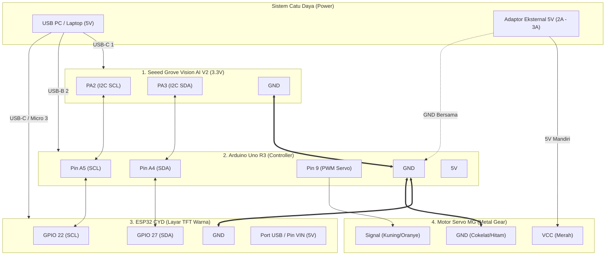

# Rekap Lengkap Wiring & Integrasi Hardware (PP2 DOC Sexing AI)

Dokumen ini adalah panduan referensi wiring dan topologi koneksi kabel antara 3 perangkat utama:
1. **Seeed Grove Vision AI Module V2** (Vision AI Sensor / NPU)
2. **Arduino Uno R3** (Controller Utama & Penggerak Motor Servo Metal Gear)
3. **ESP32 CYD (Cheap Yellow Display / ESP32-2432S028R)** (Unit Layar Tampilan TFT Warna 2.8")
4. **Motor Servo MG** (Aktuator Pemilah / Metal Gear)

---

## 1. Diagram Topologi Sistem

---

## 2. Tabel Detail Koneksi Pin-ke-Pin

### A. Jalur Komunikasi Bus I2C (SCL & SDA)
Jalur I2C dihubungkan secara paralel (*Shared I2C Bus*):

| Dari Pin Perangkat | Warna Kabel Rekomendasi | Terhubung Ke Pin | Fungsi |
| :--- | :---: | :--- | :--- |
| **Grove Vision AI V2** (Pin `PA3`) | **Putih** | **Arduino Uno `Pin A4`** & **ESP32 CYD `GPIO 27`** | Data I2C (SDA) |
| **Grove Vision AI V2** (Pin `PA2`) | **Kuning** | **Arduino Uno `Pin A5`** & **ESP32 CYD `GPIO 22`** | Clock I2C (SCL) |
| **Grove Vision AI V2** (`GND`) | **Hitam** | **Arduino Uno `GND`** & **ESP32 CYD `GND`** | Ground Bersama (*Common GND*) |

> [!IMPORTANT]
> **Tegangan Logika I2C (3.3V Safe):**
> Grove Vision AI V2 dan ESP32 CYD bekerja pada logika **3.3V**, sedangkan Arduino Uno bekerja pada 5V.
> Pada kode Arduino Uno (`mainv3.ino`), *internal pull-up* 5V pada pin A4 & A5 **dimatikan secara software** (`digitalWrite(SDA, LOW); digitalWrite(SCL, LOW);`) sehingga bus I2C murni ditarik ke 3.3V oleh ESP32 CYD / Grove. Hal ini **100% aman** dan tidak merusak chip Grove Vision AI V2.

---

### B. Jalur Penggerak Motor Servo MG (Metal Gear)

| Pin Servo MG | Warna Kabel | Hubungkan Ke | Catatan Penting |
| :--- | :---: | :--- | :--- |
| **Signal (PWM)** | **Oranye / Kuning** | **Pin 9 Arduino Uno (`D9`)** | Sinyal kendali 50 Hz Hardware Timer1 Uno |
| **VCC (Power)** | **Merah** | **Kutub Positif (+) Adaptor 5V Eksternal** | **DILARANG** colok ke pin 3.3V/5V CYD/Uno karena servo MG menarik lonjakan arus 1.5A–2.5A |
| **GND (Ground)** | **Coklat / Hitam** | **GND Bersama (Kutub Negatif Adaptor & GND Uno)** | Wajib disatukan agar referensi ground sama |

---

### C. Pinout Port Konektor ESP32 CYD (Cheap Yellow Display)
ESP32 CYD (ESP32-2432S028R) memiliki port konektor eksternal JST 4-pin (biasanya berlabel **CN1** atau **P3**) di dekat slot SD Card / tombol boot:

| Pin Port CYD | Label Pin CYD | Hubungkan Ke | Keterangan |
| :---: | :---: | :--- | :--- |
| **Pin 1** | `GND` | **GND Arduino Uno & GND Grove** | Ground bersama |
| **Pin 2** | `3V3` atau `5V` *(NC / Kosong)* | *Tidak wajib disambung jika CYD dicolok USB* | CYD diberi daya via kabel USB-nya sendiri |
| **Pin 3** | **`IO27` (SDA)** | **Arduino Uno `Pin A4` & Grove `PA3`** | Jalur I2C Data |
| **Pin 4** | **`IO22` (SCL)** | **Arduino Uno `Pin A5` & Grove `PA2`** | Jalur I2C Clock |

---

## 3. Alur Kerja Sistem (Data Flow)

1. **Grove Vision AI V2**:
   - Menerima citra bulu sayap DOC (kamera atau input gambar UI).
   - Menjalankan inferensi model MobileNetV2 INT8 pada Ethos-U55 NPU.
   - Mengambil keputusan berdasarkan threshold optimal **38.0%**:
     - $P(\text{Jantan}) \ge 38.0\% \rightarrow \text{Class 1 (Jantan)}$
     - $P(\text{Jantan}) < 38.0\% \rightarrow \text{Class 0 (Betina)}$
   - Mengirim paket protokol 5-byte via I2C:
     `[0xAA, class_id, conf_int, conf_dec, checksum]`
2. **Arduino Uno R3**:
   - Menerima paket 5-byte di Slave Address `0x55`.
   - Menggerakkan tuas motor servo MG:
     - **0°**: Jalur Betina (Kiri)
     - **180°**: Jalur Jantan (Kanan)
     - **90°**: Standby / Center
   - Mengatur jeda *cooldown* 4 detik sebelum kembali ke posisi awal 90°.
3. **ESP32 CYD**:
   - Menerima hasil deteksi di bus I2C.
   - Menampilkan visual antarmuka pameran di layar LCD warna 2.8":
     - Logo / Judul Proyek (PP2 DOC Sexing AI)
     - Status: `WAITING...` / `BETINA (HEN)` (Hijau) / `JANTAN (COCK)` (Kuning/Oranye)
     - Nilai Kepastian (*Confidence*) dalam persentase & Bar Grafis
     - Posisi Sudut Servo saat ini
