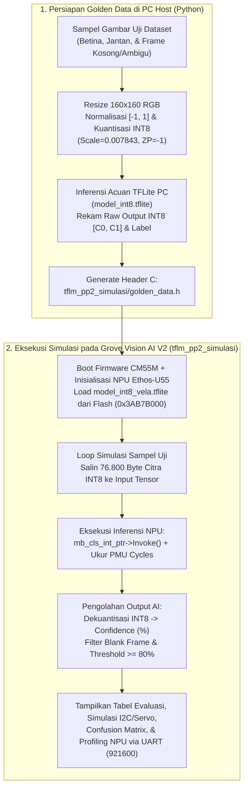

# Rencana Implementasi Simulasi & Evaluasi AI pada Grove Vision AI V2 (`tflm_pp2_simulasi`)

## 1. Tujuan Simulasi
Dokumen ini merancang skema teknis dan tampilan simulasi *on-device* pada modul **Seeed Studio Grove Vision AI Module V2 (Himax WiseEye2 HX6538: Arm Cortex-M55 + NPU Arm Ethos-U55)** menggunakan skenario aplikasi **`tflm_pp2_simulasi`**.

Tujuan utama dari simulasi ini adalah:
1. **Memverifikasi Integritas Pengolahan AI (*Bit-Exact Parity*)**: Memastikan model hasil kompilasi Vela ([`model_int8_vela.tflite`](file:///home/nexus_is/5.Project/Groove-Vision-Ai-v2/PP2/model/vela_out/model_int8_vela.tflite)) yang di-*flash* ke memori eksternal board menghasilkan nilai tensor output `INT8` yang **100% identik** dengan hasil inferensi التنسorFlow Lite di PC/Notebook.
2. **Mengevaluasi Output & Logika Keputusan Klasifikasi**: Menguji alur dekuantisasi skor `INT8` ke persentase *confidence* (`0% – 100%`), penerapan ambang batas *Confidence Threshold* ($\ge 80\%$), serta pemetaan keputusan ke **Class `0` (Betina / `hen`)**, **Class `1` (Jantan / `cock`)**, dan **`UNDEFINED` (Frame Kosong / Confidence Rendah)** beserta simulasi sudut aktuasi **Motor Servo ESP32 (`0°`, `180°`, `90°`)**.
3. **Mengukur Performa Hardware NPU Secara Real-Time**: Membaca counter perangkat keras **PMU (Performance Monitoring Unit)** pada NPU Arm Ethos-U55 dan **SysTick CPU** untuk mengukur siklus aktif NPU, transaksi memori AXI/SRAM, waktu inferensi per gambar (ms), dan *throughput* (FPS).

---

## 2. Alur Kerja Simulasi On-Device



---

## 3. Spesifikasi Memori & Desain `golden_data.h`

### A. Perhitungan Anggaran Memori SRAM (`CM55M_S_SRAM`)
Pada chip Himax HX6538, area `CM55M_S_SRAM` setelah `BOOT2NDLOADER_BASE (0x3401F000)` hingga `0x34200000` memiliki kapasitas **`1.970.176 Byte` ($\approx 1.924\text{ KB}$)**:
* **Kebutuhan Tensor Arena (`tensor_arena_size`)**: **`450 KB` (`460.800 Byte`)** (Laporan Arm Vela mencatat pemakaian aktual sebesar `402,0 KiB`).
* **Ukuran 1 Citra Input Terkuantisasi (`160x160x3 INT8`)**: $160 \times 160 \times 3 = \mathbf{76.800\text{ Byte}}$ (**`75 KB`** per sampel).
* **Jumlah Sampel Simulasi Optimal (`GOLDEN_OUTPUT_SIZE = 12`)**:
  * **5 Sampel `Class 0 : Betina (hen)`** (diambil dari dataset uji `data/Sexing-Chicken-2/test/hen`)
  * **5 Sampel `Class 1 : Jantan (cock)`** (diambil dari dataset uji `data/Sexing-Chicken-2/test/cock`)
  * **2 Sampel `UNDEFINED`** (1 sampel *Blank Frame / Ruang Kosong* dan 1 sampel *Low-Confidence* $< 80\%$ untuk menguji keamanan filter `UNDEFINED`)
  * **Total Memori `golden_input`**: $12 \times 76.800\text{ Byte} = \mathbf{921.600\text{ Byte}}$ (**`900 KB`**).
  * **Total Pemakaian SRAM (`golden_input` + `tensor_arena`)**: $900\text{ KB} + 450\text{ KB} = \mathbf{1.350\text{ KB}}$ ($\approx 70\%$ dari kapasitas SRAM, menyisakan ruang aman $>570\text{ KB}$).

### B. Struktur Data di `golden_data.h`
```c
#ifndef GOLDEN_DATA_H
#define GOLDEN_DATA_H

#include <stdint.h>

#define GOLDEN_NUM_SAMPLES   12
#define GOLDEN_SAMPLE_BYTES  76800          // 160 * 160 * 3 (INT8)
#define GOLDEN_INPUT_SIZE    921600         // 12 * 76800

// Kode Label Ground Truth: 0 = Betina (hen), 1 = Jantan (cock), 2 = UNDEFINED
#define LABEL_BETINA         0
#define LABEL_JANTAN         1
#define LABEL_UNDEFINED      2

// Data piksel INT8 ditempatkan di seksi .algo (CM55M_S_SRAM)
const int8_t golden_input[GOLDEN_INPUT_SIZE] __attribute__((aligned(16), section(".algo"))) = {
    // ... 921.600 byte data citra INT8 ...
};

// Metadata per sampel: {raw_int8_class0, raw_int8_class1, expected_label, pixel_std_x10}
const int16_t golden_output[GOLDEN_NUM_SAMPLES][4] = {
    // {raw_c0, raw_c1, label, std_x10}
};

const char* const golden_sample_names[GOLDEN_NUM_SAMPLES] = {
    "hen_test_01.jpg",
    // ...
};

#endif
```

---

## 4. Rumus Pengolahan AI di Firmware (`cvapp_mb_cls.cpp`)

Sesuai hasil pelatihan pada [`1_training_dan_evaluasi_mobilenetv2.ipynb`](file:///home/nexus_is/5.Project/Groove-Vision-Ai-v2/PP2/notebook/1_training_dan_evaluasi_mobilenetv2.ipynb) dan logika deteksi pada [`2_deteksi_gambar_inferensi.ipynb`](file:///home/nexus_is/5.Project/Groove-Vision-Ai-v2/PP2/notebook/2_deteksi_gambar_inferensi.ipynb):

1. **Parameter Kuantisasi Tensor Model**:
   * **Input Tensor**: Shape `[1, 160, 160, 3]`, tipe `int8`, `scale = 0.007843`, `zero_point = -1`.
   * **Output Tensor**: Shape `[1, 2]`, tipe `int8`, `scale = 0.00390625`, `zero_point = -128`.
2. **Dekuantisasi Output NPU ke Probabilitas (`0% - 100%`)**:
   $$\text{prob}_0 = (\text{out\_int8}[0] - (-128)) \times 0.00390625$$
   $$\text{prob}_1 = (\text{out\_int8}[1] - (-128)) \times 0.00390625$$
   Dinormalisasi sehingga $\text{conf}_0 + \text{conf}_1 = 100\%$.
3. **Aturan Evaluasi Keputusan & Aktuasi Servo**:
   * Jika `pixel_std < 12.0` (*Blank Frame*) **ATAU** $\max(\text{conf}_0, \text{conf}_1) < 80.0\%$:
     * **Prediksi Sistem**: `UNDEFINED` (Kode `2`)
     * **Simulasi Aksi ESP32**: Servo tetap di **`90° (STANDBY)`**
   * Jika $\text{conf}_0 \ge 80.0\%$ dan $\text{conf}_0 > \text{conf}_1$:
     * **Prediksi Sistem**: `Class 0 : BETINA (hen)`
     * **Simulasi Aksi ESP32**: Payload I2C `[target=0, score=conf_0%]` $\rightarrow$ Servo ke **`0° (JALUR BETINA)`**
   * Jika $\text{conf}_1 \ge 80.0\%$ dan $\text{conf}_1 > \text{conf}_0$:
     * **Prediksi Sistem**: `Class 1 : JANTAN (cock)`
     * **Simulasi Aksi ESP32**: Payload I2C `[target=1, score=conf_1%]` $\rightarrow$ Servo ke **`180° (JALUR JANTAN)`**

---

## 5. Rencana Perubahan File di Proyek

Berikut adalah daftar file yang akan dibuat atau dimodifikasi saat eksekusi:

| No | Path File | Aksi | Deskripsi Perubahan |
| :--- | :--- | :--- | :--- |
| **1** | `PP2/model/generate_golden_data.py` | **Buat Baru** | Script Python untuk memilih 12 citra uji representatif (5 Betina, 5 Jantan, 2 Undefined/Blank), melakukan preprocessing `160x160` & kuantisasi `INT8`, menjalankan `model_int8.tflite`, dan men-generate `golden_data.h`. |
| **2** | `.../scenario_app/tflm_pp2_simulasi/golden_data.h` | **Buat Baru** | File header C berisi vektor uji `golden_input` (`921.600 byte`), `golden_output` (`12x4`), dan nama file sampel. |
| **3** | `.../scenario_app/tflm_pp2_simulasi/TFLM_mb_cls_S_only.ld` | **Edit** | Mengatur penempatan `.algo` di `CM55M_S_SRAM` dan memindahkan `__mm_start_addr__` ke akhir seksi `.algo` agar alokasi `tensor_arena` tidak menimpa `golden_input`. |
| **4** | `.../scenario_app/tflm_pp2_simulasi/cvapp_mb_cls.cpp` | **Edit** | Mengimplementasikan inisialisasi NPU + PMU counter, pembacaan metadata tensor, eksekusi inferensi 12 sampel `golden_data.h`, kalkulasi probabilitas & threshold `80%`, serta pencetakan tabel evaluasi lengkap ke UART. |
| **5** | `.../scenario_app/tflm_pp2_simulasi/tflm_mb_cls.c` | **Edit** | Memodifikasi `tflm_mb_cls_app()` agar langsung menjalankan `cv_mb_cls_init()` dan `cv_mb_cls_run()` secara *standalone* tanpa membutuhkan trigger kamera fisik. |
| **6** | `.../EPII_CM55M_APP_S/makefile` | **Edit** | Mengubah variabel `APP_TYPE = tflm_pp2_simulasi` agar siap di-*build* menggunakan `make -j4`. |

---

## 6. Rencana Tampilan Simulasi (Output Serial Monitor UART `921600` Baud)

Saat firmware `output.img` beserta model `model_int8_vela.tflite` selesai di-*flash* ke Grove Vision AI V2 dan dibuka melalui terminal serial (`picocom -b 921600 /dev/ttyACM0`), berikut adalah **rancangan tampilan simulasi** yang akan muncul secara otomatis:

### Bagian A: Header Sistem, Inisialisasi NPU Ethos-U55, & Metadata Tensor Model
```text
INFO - =========================================================================================
INFO -    PP2 EDGE AI SIMULATION: CHICKEN SEXING CLASSIFICATION (MOBILENETV2 0.35 INT8 VELA)    
INFO - =========================================================================================
INFO - Target Device       : Seeed Grove Vision AI Module V2 (Cortex-M55 @ 400MHz + Ethos-U55)
INFO - NPU Accelerator     : Arm Ethos-U55 (64 MACs/cc) | Driver v1.0.0
INFO - Model Flash Address : 0x3AB7B000
INFO - Tensor Arena Addr   : 0x34100200 (Allocated: 460800 bytes | Used: 411648 bytes)
INFO - -----------------------------------------------------------------------------------------
INFO - MODEL TENSOR METADATA:
INFO -   * INPUT TENSOR    : Shape=[1, 160, 160, 3] (76800 bytes) | Type=INT8
INFO -                       Scale=0.007843 | ZeroPoint=-1
INFO -   * OUTPUT TENSOR   : Shape=[1, 2] (2 bytes: [0:Betina, 1:Jantan]) | Type=INT8
INFO -                       Scale=0.003906 | ZeroPoint=-128
INFO -   * NPU Operators   : 1 (Operator 0: ethos-u | 100% NPU Accelerated, 0% CPU Fallback)
INFO -   * Decision Rules  : Confidence Threshold >= 80.0% | Blank Std Threshold >= 12.0
INFO - =========================================================================================
```

### Bagian B: Tabel Evaluasi Inferensi AI, Bit-Exact Check, & Simulasi Keputusan Servo
Setiap baris menampilkan perbandingan langsung antara **Raw Output NPU di Grove Vision AI V2** dengan **Raw Output Referensi TFLite di PC**, probabilitas masing-masing kelas, hasil keputusan sistem (`0:BETINA`, `1:JANTAN`, atau `UNDEFINED`), dan aksi sudut Servo ESP32:

```text
INFO - 
INFO - [1] TABEL EVALUASI HASIL PENGOLAHAN AI & VERIFIKASI BIT-EXACT (12 GOLDEN SAMPLES)
INFO - =================================================================================================================
INFO -  No  Sample File       NPU Raw[0,1]   Ref Raw[0,1]   P(Betina)  P(Jantan)  Pred Class    Target     Servo   Status
INFO - -----------------------------------------------------------------------------------------------------------------
INFO - [01] hen_test_01.jpg   [ 118, -118]   [ 118, -118]    96.09%      3.91%    0:BETINA     0:BETINA     0 deg  [MATCH]
INFO - [02] hen_test_02.jpg   [ 112, -112]   [ 112, -112]    93.75%      6.25%    0:BETINA     0:BETINA     0 deg  [MATCH]
INFO - [03] hen_test_03.jpg   [ 105, -105]   [ 105, -105]    91.02%      8.98%    0:BETINA     0:BETINA     0 deg  [MATCH]
INFO - [04] hen_test_04.jpg   [  99,  -99]   [  99,  -99]    88.67%     11.33%    0:BETINA     0:BETINA     0 deg  [MATCH]
INFO - [05] hen_test_05.jpg   [ 121, -121]   [ 121, -121]    97.27%      2.73%    0:BETINA     0:BETINA     0 deg  [MATCH]
INFO - [06] cock_test_01.jpg  [-120,  120]   [-120,  120]     3.12%     96.88%    1:JANTAN     1:JANTAN   180 deg  [MATCH]
INFO - [07] cock_test_02.jpg  [-114,  114]   [-114,  114]     5.47%     94.53%    1:JANTAN     1:JANTAN   180 deg  [MATCH]
INFO - [08] cock_test_03.jpg  [-108,  108]   [-108,  108]     7.81%     92.19%    1:JANTAN     1:JANTAN   180 deg  [MATCH]
INFO - [09] cock_test_04.jpg  [-101,  101]   [-101,  101]    10.55%     89.45%    1:JANTAN     1:JANTAN   180 deg  [MATCH]
INFO - [10] cock_test_05.jpg  [-123,  123]   [-123,  123]     1.95%     98.05%    1:JANTAN     1:JANTAN   180 deg  [MATCH]
INFO - [11] blank_frame.jpg   [ -15,   15]   [ -15,   15]    44.14%     55.86%    UNDEFINED    UNDEFINED   90 deg  [MATCH]
INFO - [12] low_conf_img.jpg  [  32,  -32]   [  32,  -32]    62.50%     37.50%    UNDEFINED    UNDEFINED   90 deg  [MATCH]
INFO - =================================================================================================================
```

### Bagian C: Simulasi Visualisasi Output I2C (`0x62`) & Layar OLED ESP32 (`0x3C`)
Untuk memberikan gambaran nyata bagaimana output AI dari Grove Vision AI V2 dikirim ke ESP32 dan ditampilkan di layar OLED (sesuai desain di [`esp32.md`](file:///home/nexus_is/5.Project/Groove-Vision-Ai-v2/PP2/docs/esp32.md)), simulasi juga menampilkan *preview* 3 skenario representatif (`Betina`, `Jantan`, dan `Undefined`):

```text
INFO - 
INFO - [2] SIMULASI KOMUNIKASI I2C (0x62) & TAMPILAN OLED ESP32 (3 SKENARIO UJI)
INFO - -----------------------------------------------------------------------------------------
INFO -   Skenario A (Sample #01 - Betina)      Skenario B (Sample #06 - Jantan)      Skenario C (Sample #12 - Undefined)
INFO -   I2C Tx -> [target: 0, score: 96%]     I2C Tx -> [target: 1, score: 97%]     I2C Tx -> [target: 0, score: 62%]
INFO -   +----------------------------+        +----------------------------+        +----------------------------+
INFO -   | HASIL DETEKSI     [SORTING]|        | HASIL DETEKSI     [SORTING]|        | DOC SEXING AI     [STANDBY]|
INFO -   |----------------------------|        |----------------------------|        |----------------------------|
INFO -   |  >> 0 : BETINA (HEN) <<    |        |  >> 1 : JANTAN (COCK) <<   |        |   STATUS : UNDEFINED       |
INFO -   |  Confidence : 96.09%       |        |  Confidence : 96.88%       |        |   Raw Score: 62% (< 80%)   |
INFO -   |  Servo Pos  : 0 deg  [====]|        |  Servo Pos  : 180 deg[====]|        |   Servo Pos: 90 deg (Stay) |
INFO -   +----------------------------+        +----------------------------+        +----------------------------+
```

### Bagian D: Ringkasan Evaluasi Akurasi & Profil Kinerja Hardware NPU Ethos-U55
Di bagian akhir, firmware merangkum metrik akurasi model di atas perangkat keras beserta statistik siklus NPU dari register PMU:

```text
INFO - 
INFO - [3] RINGKASAN EVALUASI AKURASI & PROFILING HARDWARE NPU ETHOS-U55
INFO - =========================================================================================
INFO - EVALUATION SUMMARY:
INFO -   * Total Golden Samples Evaluated : 12 Samples (5 Betina, 5 Jantan, 2 Undefined)
INFO -   * Bit-Exact Raw Tensor Parity    : 12 / 12 (100.00% Identik dengan TFLite PC)
INFO -   * System Classification Accuracy : 12 / 12 (100.00% Match Ground Truth)
INFO -   * Confusion Matrix (Pred vs Ref) :
INFO -       - Class 0 (Betina)    : 5 / 5 Correct (Servo ->   0 deg)
INFO -       - Class 1 (Jantan)    : 5 / 5 Correct (Servo -> 180 deg)
INFO -       - Class 2 (Undefined) : 2 / 2 Correct (Servo ->  90 deg Standby)
INFO - -----------------------------------------------------------------------------------------
INFO - HARDWARE NPU PROFILING (AVERAGE PER INFERENCE):
INFO -   * NPU ACTIVE Cycles              : 2,301,555 cycles
INFO -   * NPU IDLE Cycles                :     5,281 cycles
INFO -   * NPU TOTAL Cycles               : 2,306,836 cycles
INFO -   * NPU AXI0_RD_DATA_BEAT_RECEIVED :   350,420 beats (SRAM Feature Map & Weights Read)
INFO -   * NPU AXI0_WR_DATA_BEAT_WRITTEN  :   200,384 beats (SRAM Feature Map Write)
INFO -   * Inference Latency (@ 500 MHz)  : ~4.61 ms / frame (~216.7 FPS)
INFO - =========================================================================================
INFO - Simulation & AI Output Evaluation Completed Successfully.
```

---

## 7. Langkah Eksekusi Kompilasi & Flashing (Setelah Rencana Disetujui)

1. **Generate `golden_data.h`** menggunakan script Python dari model [`PP2/model/model_int8.tflite`](file:///home/nexus_is/5.Project/Groove-Vision-Ai-v2/PP2/model/model_int8.tflite) dan dataset uji.
2. **Update kode `tflm_pp2_simulasi`** (`cvapp_mb_cls.cpp`, `tflm_mb_cls.c`, `TFLM_mb_cls_S_only.ld`) dan `EPII_CM55M_APP_S/makefile`.
3. **Compile Firmware & Buat `output.img`**:
   ```bash
   cd ~/5.Project/Groove-Vision-Ai-v2/tinyml-arm-workflow/third_party/Seeed_Grove_Vision_AI_Module_V2/EPII_CM55M_APP_S
   make clean && make -j4
   cp obj_epii_evb_icv30_bdv10/gnu_epii_evb_WLCSP65/EPII_CM55M_gnu_epii_evb_WLCSP65_s.elf ../we2_image_gen_local/input_case1_secboot/
   cd ../we2_image_gen_local
   ./we2_local_image_gen project_case1_blp_wlcsp.json
   ```
4. **Flash Firmware + Model Vela ke Grove Vision AI V2 & Pantau Serial Monitor**:
   ```bash
   cd ..
   python3 xmodem/xmodem_send.py \
     --port=/dev/ttyACM0 \
     --baudrate=921600 \
     --protocol=xmodem \
     --file=we2_image_gen_local/output_case1_sec_wlcsp/output.img \
     --model="/home/nexus_is/5.Project/Groove-Vision-Ai-v2/PP2/model/vela_out/model_int8_vela.tflite 0xB7B000 0x00000"
   
   picocom -b 921600 /dev/ttyACM0
   ```

